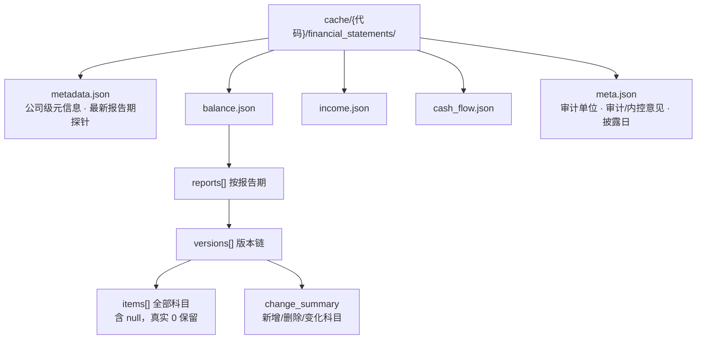
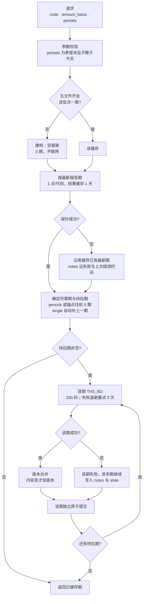
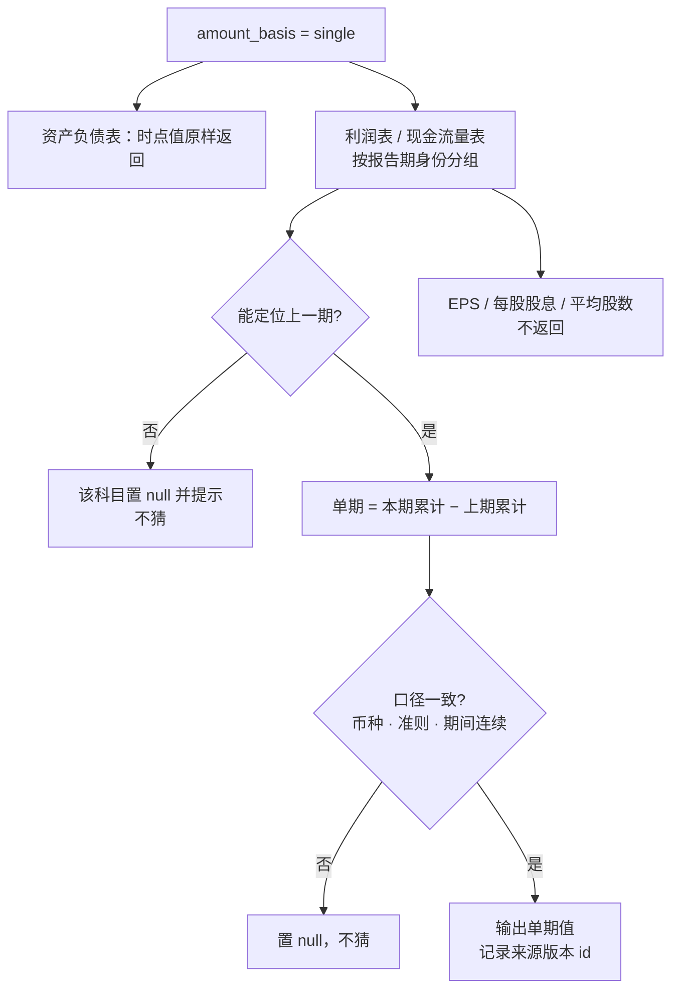

# 行为细则：财报工具 get_financial_statements

> 本文是「程序应该是什么样」的子文档，只描述 `get_financial_statements` 及其配套工具的行为。总纲与其它工具见 [`docs/market-data架构设计.md`](market-data架构设计.md)；客观上游能力见 [`字段与数据源支持情况.md`](../字段与数据源支持情况.md)；科目清单见 [`ifind财务报表科目.md`](../ifind财务报表科目.md)。
>
> 状态标记：❓=已拍板但代码尚未实现（差异见 `docs/market-data调整方案稿-2026-10-20.md` §1）。

## 1. 这个工具做什么

输入带市场后缀的代码，返回三张报表（资产负债表 / 利润表 / 现金流量表）加一张报表信息表（meta），按报告期组织成矩阵或长表。同一家公司的数据永远只从一个源取，不做跨源拼接。

- A股、北交所：iFinD `THS_BD`，报表类型固定 `100`（合并报表）。每个报告期一次调用携带全部科目码。报告期用**季度末日期**表示：`2025-12-31`=FY25 年报、`2025-06-30`=中报、`2025-03-31`=一季报、`2025-09-30`=三季报。
- 港股、美股：东财 datacenter，无 meta 表。报告期按上游实际报告截止日匹配，暂不强制季度末；本轮只做 A 股/北交所，港美维持现状不动。
- 科目基准是本地注册表330项：资产负债表133、利润表83、现金流量表110、meta4。利润表不含报表信息行（那3行已归入meta）。
- 金融行业（银行/保险/券商）专用科目由上游返回空值，按「该公司不适用」处理，不做行业模板适配。
- 只做合并报表；母公司报表不实现、不留参数。

## 2. 缓存结构

**图1 财报缓存结构：五文件与 reports/versions/items 层级**

每家公司一个目录 `cache/{代码}/financial_statements/`，五个文件：

- `metadata.json`：公司级元信息（code/market/sources/filings），不存报告期清单；
- `balance.json` / `income.json` / `cash_flow.json`：三张报表；
- `meta.json`：报表信息（审计单位、审计意见类型、内控审计意见类型、定期报告实际披露日期）。

三表与 meta 的每个文件内部结构一致：`reports[]` 按报告期分组，每期有 `current_version_id` 与 `versions[]`；每个版本含该期全部科目 `items[]`（**含 null，真实 0 原样保留**）、报告级元信息、`change_summary`（新增/删除/变化科目）。

**读取条件**：五个文件齐全、JSON 可解析、`update_batch_id` 一致。任一不满足即视为无缓存。

**新鲜期（2026-10-21 重定义）**：判断依据是「有没有新披露的报告期」，不是「距上次刷新多久」。财报一经披露即稳定，只有会计差错更正才会变，所以：

- 已拉到的报告期**永不自动重拉**；`force_refresh=true` 才重拉请求范围内的期（对应重述/更正）。
- 缺的期只在判定「已披露」时才拉：先调用最新报告期探针 `ths_regular_report_latest_rp_stock`（每代码 1 个数据点，返回 `YYYYMMDD`），只拉「不晚于最新报告期」且缓存缺失的期；晚于最新期的期不请求。
- 探针结果缓存 **1 天**：`metadata.latest_report_probe` 记录返回的最新报告期与探测时间，1 天内直接复用，满 1 天重新探测；**`force_refresh=true` 跳过该缓存，立即重探**。
- 探针失败**不阻塞**：把缓存中已有的最新报告期当作探测结果（等同于「探测成功且没有新期」），照常走后续流程，notes 记录「探测最新报告期失败」、失败原因与上次探测时间；缓存为空（首次拉取）时没有锚点可用，直接报错并提示显式传 `periods`。
- 报告期由 `periods` 显式指定（每个元素是 `YYYY-MM-DD` 的季度末）；不传时以探针拿到的最新报告期为锚，往前取最近 5 个季度末。
- 请求指定 `statements` 只影响返回哪几张表，不影响拉取范围（拉取始终取全部表）。

## 3. 一次调用发生了什么（❓惰性拉取待实现）

**图2 惰性拉取流程：建档、探最新期、只拉缺失期、每期独立落盘**

下面 9 步是惰性拉取的目标行为，当前代码仍是全历史回补（差异：不写空框架、不按请求范围筛期、单期失败即整批失败）。实现进度见 `docs/market-data调整方案稿-2026-10-20.md` §1。

1. **参数校验**：`amount_basis` 必填（cumulative/single）；`statements` 只能是四张表的子集；`periods` 每个元素必须是 `YYYY-MM-DD` 且为季度末（0331/0630/0930/1231），且不晚于今天；`items` 取值合法。
2. **读缓存**：五文件齐全且批次一致 → 读到；否则按无缓存处理。
3. **建档**：无缓存时先写五文件空框架（0 个报告期、`last_successful_update` 留空），不联网；空框架不算新鲜，下次调用仍会拉取。
4. **探测最新期**：`latest_report_probe`（1 天内有效）未过期且非 `force_refresh` 时直接复用，否则调用 `ths_regular_report_latest_rp_stock`（1 点/代码）并写回 `metadata`。探针失败按 §2 处理：以缓存已有最新期顶替，notes 记录失败原因与上次探测时间；缓存为空则报错。
5. **确定所需期与待拉期**：`periods` 有值直接用它；为空则以最新期为锚往前取 5 个季度末。`amount_basis=single` 时自动把每期在同一财年内的上一期纳入拉取范围（Q2→Q1、Q3→Q2、年报→Q3；Q1 无上一期），**调用方只需传目标期，不用自己补上一期**；返回只包含请求的期，notes 说明自动补拉了哪几期。待拉期 = 「所需期 ∩ 不晚于最新期」−「缓存已有期」；`force_refresh` 时缓存已有期也计入待拉。
6. **逐期拉取**：每个待拉期一次 `THS_BD` 带全部 330 码；一次首发 + 三次退避重试（0.5/2/5 秒）。
7. **版本合并**：把该期结果与已有版本比对（哈希是否变化），变化则追加新版本，不变化只更新 `last_seen_at`。
8. **每期独立提交**：同一报告期的三表 + meta 在同一次原子提交里落盘（要么全写、要么全不写）；不同报告期互不回滚。
9. **返回**：按 `statements`、`items` 过滤，渲染成矩阵（MCP）或长表（CLI/CSV）。

**失败语义**：某一期失败不影响其余期——成功的期照常落盘，返回 `ok=true`、`stale=true`，`notes` 列出失败的报告期与原因；全部失败且无旧缓存才返回错误。

## 4. 单期（single）怎么算

**图3 单期金额现算：累计相减与口径校验**

- 资产负债表恒为时点值，`amount_basis` 对它不生效。
- 利润表与现金流量表：单期金额 = 本期累计 − 上期累计。
- 「上期」按报告期身份认定（同一会计年度内的上一期），跨年度不混算。
- 一季报没有同一会计年度的上一期，**Q1 单季 = Q1 累计**，不置 `null`。
- 上期缺失（如缓存尚未拉 Q1）、或两期口径不一致（会计期间长度不同、科目集合不同、币种或准则变化）→ 该科目置 `null`，不猜。
- 不参与差分的科目：EPS、每股股息、加权平均股数等非加总科目在 single 下不返回。
- 单季所需的上一期由工具自动补拉，调用方只传目标期；返回里只出现请求的期，补拉的期只在 notes 说明。
- 单期值不落盘，永远按最新累计版本现算；查 Q2 用 Q1，所以单独查一个季度也能算对。

## 5. items 匹配与返回形态

- 匹配优先级：科目码 / 中文全名精确 → 简称精确 → 按字符顺序的关键词匹配。
- 单候选：直接返回，并在 notes 说明匹配方式；多候选：进 `failed_items`，附各候选最近金额供 AI 判断；无候选：报失败，不计算毛利、毛利率一类衍生指标。
- 名称来源：A 股/北交所取注册表中文名；港美取东财中文名，未映射时保留上游原名。名称原样，不翻译、不跨市场映射。
- MCP 返回 JSON 信封 + `markdown` 矩阵：每张表一张，报告级元信息作行，金额两位小数，列名直接用上游报告截止日（不做季度推断，美/港股财年灵活）。
- CLI 与 CSV 导出为长表，含版本字段与报告元信息。
- 超过 200 行自动导出到 `cache/_auto_export/`，只返回路径与元信息。

## 6. 配套工具 get_data_catalog

纯本地只读：汇总该公司**已缓存**报告期中至少出现过一次非空金额的科目，给出每个科目的最早、最晚有效报告日。不联网、不写缓存。

惰性拉取语义下，它只反映「已经拉过」的报告期；需要某期数据时先查询该期触发拉取。

## 7. 版本与修订

- 版本标识由「报告期 + 该期全部科目金额 + 报告级元信息」计算哈希；内容变即新版本，旧版本保留可查。
- 同一报告期可能同时存在多个版本（上游更正、重述）；默认只返回最新版本，`include_versions=true` 返回范围内全部版本。
- 一次刷新中没有被重新取到的旧期标记为「本轮未出现」，不删除；`change_summary` 记录本次新增、删除、变化的科目码与变化的元信息键。
- 不伪造未观察的版本；上游给什么就是什么。

## 8. 边界与已知限制

- **审计信息恒空**：审计单位、审计意见类型、内控审计意见类型在 iFinD 数据接口返回空字符串，矩阵对应行为空。
- **金融专用科目空值**：银行/保险/券商专用行在一般企业返回空值，按不适用处理。
- **港美股无 meta 表**：东财不提供报表信息表。
- **配额**：财报接口月配额 60 万数据点，与行情渠道独立；共用账号的其他任务可能提前耗尽。
- **B 股三表**：iFinD 通道未验证，需要时先探针确认。
- **美股股本/市值**：iFinD 单点对部分品种返回0或空，属上游边界，不回退其他源。美股三表本身走东财，不经过 `THS_BD`。
