# market-data 调整方案稿（2026-10-20）

> **性质**：临时文档。只记录还没做完的改造步骤、待用户提供的资料、待定事项。每完成一步，把结论并入 `docs/market-data架构设计.md`、在 `docs/决策记录.md` 加一条，全部完成后删除本文。
>
> **不看这里就看什么**：程序应该是什么样 → 架构设计；客观上游能力 → `字段与数据源支持情况.md`（附件：`ifind财务报表科目.md`）；变动历史 → `docs/决策记录.md`。

## 0. 两个MCP的统一分层框架（2026-10-23讨论图）

> **待确认、未实施。** 函数名仅用于讨论职责。§1—§5保留旧方案，涉及全面切iFinD的方向待重新确认。下图为调用顺序示例，不代表2026Q3已披露或已有可取数据。

**统一框架调用顺序：以某公司2026Q3单季度营收、毛利率为例**

```mermaid
%%{init: {"flowchart": {"curve": "stepBefore", "nodeSpacing": 55, "rankSpacing": 70, "padding": 16}}}%%
flowchart TD
    AI["① AI或CLI调用<br/>get_data（公司，2026Q3，单季度，营收、毛利率）"]
    AI --> VALID{"② validate_request（请求）<br/>只校验参数是否合法"}
    VALID -->|不合法| ERR["返回参数错误与提示"]
    VALID -->|合法| MAIN["③ execute_request（请求）<br/>只组织调用顺序、收集各项结果"]

    MAIN --> REV["④ plan_item（公司，2026Q3，单季度，营收）<br/>需要Q3、Q2累计营收"]
    MAIN --> GM["④ plan_item（公司，2026Q3，单季度，毛利率）<br/>需要Q3、Q2累计营收及营业成本"]
    REV --> NEED["⑤ merge_requirements（各项依赖）<br/>合并重复需求<br/>得到Q3、Q2的营收、营业成本"]
    GM --> NEED
    NEED --> CHECK{"⑥ check_cache（公司，所需范围）<br/>只检查覆盖、有效性与缺失项<br/>不联网，不计算指标"}

    CHECK -->|齐全且有效| READ
    CHECK -->|缺少Q3、Q2等数据| UPDATE["⑦ update_data（公司，缺失或待刷新范围）<br/>只组织更新，完成后返回更新状态"]
    UPDATE --> ROUTE["⑧ resolve_provider（代码后缀，数据类型）<br/>只选择市场通道及已约定来源<br/>本例为SH/SZ/BJ财报 → 东财"]
    ROUTE --> FETCH["⑨ fetch（选定来源，公司，所需范围）<br/>只取数，内部处理分页与有限重试<br/>东财可返回整表历史；iFinD可逐期返回<br/>其他数据可选新浪、SEC等，不自动换源"]
    FETCH --> GOT{"取得可用数据批次?"}
    GOT -->|是| ADAPT["⑩ normalize（返回数据）<br/>只转换为对应业务的统一格式<br/>保留来源、单位、口径及实际覆盖范围"]
    ADAPT --> WRITE["⑪ write_cache（标准数据，更新范围）<br/>只校验、合并、保存版本并安全落盘<br/>逐期结果更新对应期；整表结果合并各期<br/>未返回的旧数据不自动删除"]
    WRITE --> DONE["⑫ update_data返回<br/>已写入范围、失败部分及错误信息<br/>写入失败也如实返回，不宣称完成"]
    GOT -->|无可用数据| DONE
    DONE --> RECHECK{"⑬ check_cache（公司，原所需范围）<br/>更新返回后，再次检查缓存<br/>不把更新完成直接当作数据齐全"}
    RECHECK -->|齐全且有效| READ["⑭ read_cache（公司，报告期，基础科目）<br/>只读取并返回规定格式<br/>上层不关心取数来源及缓存写入方式"]
    RECHECK -->|仍缺失或无效| PART["保留可用项并标明缺失或过期<br/>受影响指标不强算，不无限重拉<br/>全部不可用则返回错误"]
    PART --> OUT

    READ --> SINGLE["⑮ calculate_single（累计基础数据）<br/>只做同口径单季差分<br/>Q3营收＝Q3累计营收－Q2累计营收<br/>Q3成本＝Q3累计成本－Q2累计成本"]
    SINGLE --> REVD["⑯ get_item_result（营收）<br/>直接取已得到的单季营收"]
    SINGLE --> GMD["⑯ calculate_gross_margin（单季营收，单季成本）<br/>毛利率＝（单季营收－单季成本）÷单季营收<br/>缺值、口径不一致或零分母时不强算"]
    REVD --> COLLECT["⑰ collect_results（各项结果）<br/>只组装营收、毛利率及状态说明"]
    GMD --> COLLECT
    COLLECT --> OUT["⑱ format_result（业务结果，输出要求）<br/>只做展示单位换算、排版及导出<br/>小表返回数据；大表或指定导出返回CSV<br/>其他业务可按页返回正文或输出PNG"]
    OUT --> RETURN["⑲ MCP或CLI返回最终结果<br/>数据或文件路径，以及缺失、过期、失败说明"]
```



> 同一种业务数据使用唯一缓存与读取格式，不同数据类型分别定义。两个MCP共用职责划分；公告解析/OCR可另存加工缓存，关联原文件与解析版本。图中读取函数保持只读，取数和加工函数不直接改基础缓存。

## 1. 未完成的改造步骤

> 范围（2026-10-22 用户更新）：长期方向是全部市场、全部公司都切 iFinD；财报惰性拉取已完成；**当前优先做步骤 4（profile 五 section 切 iFinD）与步骤 6（主营构成）**。A股流通股本不切 iFinD（新浪全历史逐日够用，不浪费同花顺额度），步骤 3 撤销；金融企业、港美、ratios 本轮仍不动。

| # | 步骤 | 阻塞于 |
|---|---|---|
| 4 | **profile 五 section 逐个切 iFinD**（A 股）：现状东财/巨潮/新浪/同花顺多源，切后删除全部补充源机制 | 手册 ②-⑤ |
| 5 | **get_financial_ratios 实现**：当前工具面不提供（架构 §4 标 ❌ 未实现） | 手册 ⑦（指标集） |
| 6 | **主营构成**（行业/产品/地区三维度）作为 statements 扩展。完整方案见 §4.4 | 待 §3 P7/P8 拍板 |

> 步骤 7「财报惰性拉取实现」已于 2026-10-21 完成（代码、测试、真实联网验证），细则并入 `docs/行为-财报工具.md`。

### 轮外待收尾

- chart 注册收尾：Hermes 注销 market-data-chart、能力库条目停用、用户版重导出。2026-10-19 用户拍板**先不动**，旧 chart MCP 继续以旧代码运行。
- 行情遗留：
  - `end` 落在周末/节假日时请求层挂起（>10 分钟 CPU 空转，根因未诊断），本轮不修；
  - 美股 iFinD hfq 的 OHL 在拆股日还原是否正确待验证；
  - 接口返回格式速查表需按当前上游复测。
- holders 串公司（`fetch_sina_holders` 前缀错误致静默回落中国平安，A 股缓存不可信）：随步骤 4 切 iFinD 自然消失，切源时旧缓存重建。

## 2. 待用户提供的资料

> **2026-10-22 更新**：步骤 4/6 的前置（原②-⑥）已解除——用户 Excel 模板（`0-IPO信息+财报数据 ifind.xlsx`）提供全部指标码，SDK 逐项实测 64 项通过（分红按年度统计口径，逐笔明细用户拍板不需要），实测记录见 `字段与数据源支持情况.md` §7 指标群实测块。**步骤 4/6 可开工。**

仍待手册：⑦估值指标（PE/PB/PS，TTM/LYR）与财务比率指标、直接流通市值指标（步骤 5 ratios 用）；⑧各项渠道归属与速率/计点细则。

**铁律 1**：iFinD 参数严禁猜测或试探变体，缺手册就停（见 AGENTS.md）。

## 3. 待定事项（拍板后写入架构设计）

**已定案（2026-10-21）**：P1 不传日期默认最近5期；P2 每期独立提交（同期四文件原子、跨期不回滚）。细则已写入 `docs/行为-财报工具.md` §2/§3。

| # | 事项 | 备选 |
|---|---|---|
| P4 | 十大流通股东是否随十大股东一并纳入 | 现状仅十大股东历史 |
| P5 | 行情是否加 force_refresh / 复权历史重建 | 现状无；若加按同基准重建，不跨批次混装 |
| P6 | ratios 历史序列与缓存新鲜期细则 | 待指标集定稿 |
| P7 | items 三个维度值的确切名称（用户已纠正为「分产品营收」式命名，不是「按产品」） | 候选：`分产品营收`/`分行业营收`/`分地区营收`，请给准确名 |
| P8 | export_path 含 bs 的 CSV 形态 | 建议：主CSV=三表长表不变，bs 追加 `{路径去.csv}_segments.csv`（列=statement,period,rank,name,income,gross_profit）；备选：拼进主CSV（需造通用列，不推荐） |

## 4. 各步骤设计要点（未实施，供开工时参照）

### 4.2 profile 五 section 切 iFinD（A 股）

| section | 改造后 |
|---|---|
| profile 概况 | iFinD 单源（原巨潮） |
| ipo | iFinD 单源（原巨潮 + 新浪补全，机制删除） |
| dividends | iFinD 单源（原东财 + 3 源补全，删除）；预案/批准/实施不重复相加，不分配记录不伪装成缺失 |
| forecast | iFinD 单源（原东财 + 同花顺补全，删除）；预测年份不写死，不混合不同机构样本 |
| holders | iFinD 单源；保留历史多期十大股东；十大股东 ≠ 十大流通股东 |

30 天新鲜期与 section 分文件缓存结构不变；旧 A 股 holders 缓存切源后重建。分红注意 A 股 `107`=现金分红的分市场语义。

### 4.3 get_financial_ratios 实现

估值快照（PE/PB）+ 财务比率（营收/归母/扣非/毛利率/ROE/经营现金流第一批）；金额项优先复用三表，比率取 iFinD 明确口径值；指标中文名原样返回，不附指标码。缓存按日新鲜（区别于 profile 的 30 天）。原「东财英文列名」设计作废。

### 4.4 主营构成扩展 business_segments（完整方案，2026-10-22 讨论稿，待 P7/P8 拍板后实施）

> 实测依据：`字段与数据源支持情况.md` §7「公司信息指标群」两块（6 家 × 多期 × 多维度约 180 次调用），上游能力已探明。数据源=iFinD `THS_BD`，仅 A股/北交所。

**已拍板决策**：

| # | 决策 |
|---|---|
| D1 | `statements` 默认五表全含（不传=含 business_segments） |
| D2 | 只做累计披露原值：不参与 single 单季差分，`amount_basis` 对其无效果 |
| D3 | 期集与三表一致：季报照常请求；每期每维度**固定返回排名1-5共5行、字段全齐**，iFinD返回什么填什么（0/空串/`--`/`-` 全部原样保留，不做判断与清洗；仅pandas缺失NaN转null——那不是上游值，是序列化要求） |
| D4 | 不聚合：按维度长表，行=报告期×排名×项目，字段零增减，跨期同名不合并 |
| D5 | 保留 rank（上游排名参数原值 1-5） |
| D6 | 金额=元原值；**营收占比（income_ratio）与毛利率（gross_margin）系统内部计算**，随行返回并入库，调用方无需再算；不造"成本"字段 |
| D7 | 无版本链：同期重拉整期覆盖 |
| D8 | items 支持维度值过滤 bs（名称见 P7），与科目名过滤混用互不干扰 |
| D9 | export_path 导出含 bs（形态见 P8） |

**输入**：

| 参数 | 行为 |
|---|---|
| statements | 默认含 bs（D1）；港美传 bs 返回 null+notes |
| amount_basis | 对 bs 无效果（D2） |
| periods | 不变；bs 期集=三表期集（D3） |
| items | 科目名（三表）+维度值（bs，D8）可混用 |
| include_versions | 对 bs 无效果（D7） |
| force_refresh | 对 bs 同效：重拉范围内已有期 |

**输出**：与三表同模式——**数据本体渲染进 `markdown` 字段，JSON 不返回 business_segments 数据区块**（rows 同待遇）。markdown 中每维度一张长表：

```markdown
## 主营构成——按产品（单位：元）

| 报告期 | rank | 项目 | 收入 | 毛利 | 营收占比 | 毛利率 |
|---|---|---|---:|---:|---:|---:|
| 2025-12-31 | 1 | 茅台酒 | 146499906480.49 | 137015148654.95 | 41.2% | 93.5% |
| 2025-12-31 | 4 |  |  |  |  |  |
```

- 行=报告期×排名×项目；iFinD原值原样（`--`/`-`/空串照写）；营收占比=income÷当期营业总收入（分母取income表，该期不可用时该列留空+notes）、毛利率=gross_profit÷income；上游值非数值（如`--`）时派生列留空
- 计算在 service 组装时完成（分母来自同批拉取的 income 表），**随行入库、随行返回**，调用方无需再处理

**缓存**：第六文件 `business_segments.json`（与三表文件同构，reports 按期排）：

```json
{
  "meta": {"…同四表 meta 结构…", "statement": "business_segments", "shape": {"reports": 2}},
  "item_catalog": [],
  "reports": [
    {"report_date": "2025-06-30", "observed_at": "…",
     "dimensions": {
       "product":  [
         {"rank": 1, "name": "茅台酒", "income": 75589948903.79, "gross_profit": 70940650242.56, "income_ratio": 0.4120, "gross_margin": 0.9383},
         {"rank": 4, "name": null, "income": null, "gross_profit": null, "income_ratio": null, "gross_margin": null}
       ],
       "industry": [
         {"rank": 1, "name": "酒类", "income": "168774585187.65", "gross_profit": "--", "income_ratio": null, "gross_margin": null}
       ],
       "district": [{"rank": 1, "name": "国内", "income": 86490107535.14, "gross_profit": 78945741785.69, "income_ratio": 0.5288, "gross_margin": 0.9131}]
     }}
  ]
}
```

行六字段 `rank/name/income/gross_profit/income_ratio/gross_margin`（period 在桶级 report_date，组装返回时并入行）；**值原样透传**：上游给 0/空串/`--`/`-` 原样存（示例 industry 行 gross_profit="--"），仅 pandas 缺失 NaN 转 null（序列化要求，非上游值）；派生两字段仅当 income/gross_profit 与分母均为数值时计算，否则 null。六文件强一致（旧五文件缓存整体重建）；无版本链（同期覆盖）；`get_data_catalog` 对无 versions 表自然跳过。

**拉取**（一次无缓存调用 600519 cumulative 全量）：

| 动作 | 请求数 | 数据点 |
|---|---|---|
| 探最新报告期 | 1 | 1 |
| 三表（每期1次×5期） | 5 | ~1670 |
| bs（每期5次×5期：9指标合并×排名1-5） | 25 | 225 |

首轮约31次请求/~1900点（月配额0.3%）/15-30秒；已缓存0请求亚秒级。差分分表独立（bs失败期下次自愈补拉）；偶发 `request data error` 退避重试；会话静默失效自动重登录；同码重复×多排名不支持（逐排名调用）。

**实现步骤**（敲定后）：① 缓存层 `FINANCIAL_FILES`+`merge_business_segments` ② `ifind.fetch_business_segments`+login 自愈 ③ service 分表差分+`_refresh_ifind` 重写+东财分支 bs 空 payload ④ 主函数 items 分离+bs 组装+export 两文件 ⑤ server.py docstring+宽表渲染 ⑥ cli 对齐 ⑦ 测试（fixture 补第六文件+联网6场景）⑧ 文档并入+方案稿步骤关闭 ⑨ 分步提交。

**bs 验收**（补充 §5）：首拉六文件齐且 bs 有值；重复请求 0 联网；single 时 bs 行数不变；items 维度过滤生效；00700.HK bs=null+notes；季报期上游无值时 5 行与字段仍齐全、原值原样入库；旧缓存自动重建。

## 5. 验收样例（剩余步骤的合格标准）

| 场景 | 合格结果 |
|---|---|
| 全历史后复权收盘 | raw=新浪全历史；美股 hfq 按 BD 补全或明确范围；不存在静默截断 |
| 精选科目财报（600106.SH 营收/归母/扣非/现金流近 5 年） | 报告截止日矩阵，科目码可追溯 |
| 单季利润（某年 Q2，single） | Q1 参与相减，EPS 不相减并提示 |
| 三表历史修订 | 原版本保留可查，不伪造未观察的版本 |
| 股东历史 | 公司一致，截至日与公告日分开，数量比例单位明确 |
| 主营构成 | 分维度返回，不把两维度收入合计；细则见 §4.4 bs 验收 |
| 盈利预测 | 年份动态、统计口径明确，不混机构样本 |
| 行情图 | PNG 可读，数据与 get_quote 一致，事件对齐正确 |
| 少量公司比较（CLI 三家） | 各自币种报告期可见，一家失败不抹掉其余 |
| 额度不足/代码非法 | 清晰报错，不静默换源 |
