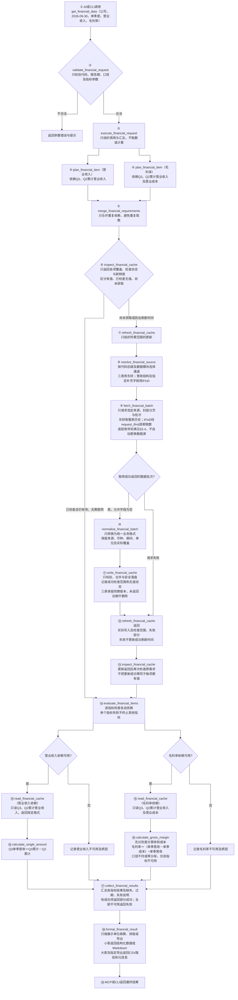
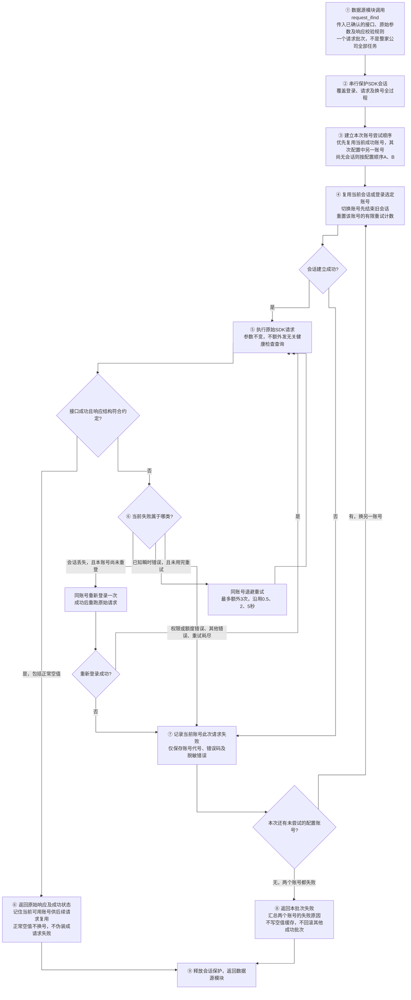

# market-data调整方案稿（2026-10-23）

> **本轮只调整市场数据MCP。公告MCP的代码、工具、缓存、文档、注册和部署完全不动。**
>
> 本文为待实施方案，更新文档不等于授权实施代码。取代2026-10-20方案稿；未完成的目标与待定事项集中在本文，完成后再并入[架构设计](<market-data架构设计.md>)及其子文档。上游客观能力仍以[支持情况](<../字段与数据源支持情况.md>)为准，不将目标覆盖写成已验证能力。

## 1. 调用顺序与模块职责

**一张图看完整调用顺序，以2026Q3单季度营业收入和毛利率为例**



图中报告期为调用示例，不表示2026Q3已披露。内部函数名为职责约定，可按实际模块组织；图示分支表示独立处理，不要求并行执行。读取、加工均不联网，取数不直接写业务缓存。读取时按批次复用相同基础数据，避免两个指标重复读盘。

## 2. 数据源分工与工具名称

### 2.1 行情与日频指标

| 数据 | SH/SZ/BJ，含A/B股 | HK | US |
|---|---|---|---|
| 不复权开高低收、成交量 | 新浪 | 新浪 | 新浪 |
| 后复权收盘 | 新浪 | 新浪 | iFinD |
| 成交额 | 新浪 | 新浪 | iFinD |
| 流通股本 | 新浪 | iFinD | iFinD |
| 总股本 | iFinD | iFinD | iFinD |
| 前复权、后复权开高低 | 用不复权价与后复权收盘计算 | 同左 | 同左 |
| 总市值、流通市值、换手率 | 用已有价格、股本及成交量计算 | 同左 | 同左 |
| PE等日频估值 | 用已有行情及财报计算，公式口径明确后纳入 | 同左 | 同左 |

新浪、东财为数据源，AKShare为调用库。iFinD近5年日期序列与窗口外基础数据补取沿用已核验写法；早期股本月频采样仍须标明覆盖与精度，不承诺逐日真实变化。价格复权与市值口径沿用现行约定。

### 2.2 财报、报表信息与营收结构

| 模块 | SH/SZ/BJ | HK | US |
|---|---|---|---|
| 资产负债表、利润表、现金流量表 | 东财，按市场通道取得实际返回的行业模板 | 东财 | 东财 |
| 公告日、更新日、币种、财报审计意见等 | 东财已有字段直接保留 | 东财已有字段保留，缺项明确标注 | 东财已有字段保留，现有SEC提交元信息关联维持，不扩展 |
| 审计单位、内控审计意见等指定缺项 | iFinD候选补充，逐字段验证参数和有效值 | 待手册及验证 | 待手册及验证 |
| 营收结构，产品/行业/地区 | iFinD | 尚无已验证方案，不承诺覆盖 | 尚无已验证方案，不承诺覆盖 |
| 财报期比率及同比 | 用已有财报本地计算 | 同左，保留当地财年与期间 | 同左，保留当地财年与期间 |

金融企业暂不做专门科目补齐或跨源拼金额，保留东财实际返回及缺项。补充字段失败不影响三表；iFinD审计字段已有空值记录，不把列出字段等同于已能补齐。市场只按后缀路由，不凭代码数字开头区分A/B股。

### 2.3 公司信息

| 模块 | 目标来源 | 已验证边界与实施条件 |
|---|---|---|
| 概况、IPO | iFinD | A股/北交所使用已验证指标；港美字段与参数单独验证 |
| 年度分红、含回购统计 | iFinD | A股使用已验证年度口径；港美年度口径待验证 |
| 一致预期 | iFinD | A股按预测年与数据日期取营收、归母等；港美另行验证 |
| 历史十大股东 | iFinD | A股/北交所使用已验证历史期与排名；港美待验证 |

公司信息全用iFinD为目标，不套用A股指标码到港美。未验证部分不自动切源；实施到对应模块前保留当前能力并明确未完成。旧A股股东缓存不可信，切源后隔离重建；不自动删除用户数据。

### 2.4 对外工具及内部命名

| 目标MCP工具 | 职责 | 与当前接口的关系 |
|---|---|---|
| `get_quote` | 行情及日频派生指标 | 保留名称 |
| `get_financial_data` | 三表、报表信息、营收结构及财报期派生指标 | 由`get_financial_statements`改名，覆盖范围更明确 |
| `get_market_data_help` | 查询市场数据MCP各工具的能力、指标、历史范围、刷新规则及指定公司本地缓存情况 | 将原`get_data_catalog`扩展为帮助入口，取消仅限财报的`get_financial_catalog`目标名 |
| `get_company_profile` | 公司概况、IPO、分红、预测、股东 | 保留名称与sections分类 |
| `get_quote_chart` | 复用行情服务绘图 | 保留名称 |

不新建`get_financial_ratios`，不设含义宽泛的公开`get_data`。CLI沿用已有批处理惯例，对应使用`get_financial_data_batch`与`get_market_data_help`等明确名称。实际改名时核对MCP、CLI、测试、导出说明及仓库内所有调用点，旧名不再注册为另一套重复工具；本次仅更新方案，不改变现有接口。

内部函数按数据域命名，如图中的`inspect_financial_cache`；行情、公司信息分别使用`quote`、`company`限定，避免同名`fetch`或`get_data`表达不同职责。

### 2.5 市场数据help工具

`get_market_data_help`覆盖整个市场数据MCP，不查询或调整公告MCP。工具描述只保留用途、参数入口及查询帮助的方法，较长或易变的能力信息由help按需返回。

| 查询内容 | 返回内容与依据 |
|---|---|
| 工具能力 | 当前实际注册的工具、参数含义及使用示例，不把方案中未实现能力当成现状 |
| 指标与科目 | 各市场支持的原始字段、派生指标、营收结构维度、计算依赖与口径 |
| 时间范围 | 上游已验证历史限制、单次请求限制、报告期/财年要求；未知范围明确标注未知 |
| 更新频率 | 当前程序实际执行的刷新与缓存复用规则，区分程序检查频率与上游披露频率 |
| 指定公司缓存 | 已缓存科目、报告期/日期范围、最近成功检查时间、有值/无值状态；未缓存不等于上游不支持 |
| 导出帮助 | 多年全科目请求方式、CSV形态、部分成功与失败说明 |

建议查询入口为`tool`、`market`、`code`和`topic`，可按工具、市场或公司缩小结果。帮助、工具参数校验和计算依赖尽量复用同一份能力定义；运行状态从注册信息及缓存元信息读取，不再维护一套容易过时的独立长文。help纯本地只读、不拉数、不登录iFinD，也不返回账号或密码。原财报缓存科目目录作为其中一个查询主题保留。

### 2.6 财报请求参数、默认范围与全科目导出

以下为本轮已确认的目标接口，尚未实施。

```python
get_financial_data(
    code,
    amount_basis,             # 必填：cumulative / single
    periods=None,             # 不传默认最近5个已披露报告期
    statements=None,          # balance / income / cash_flow / segments / meta
    items=None,               # 原始科目、派生指标或营收结构维度；ALL_ITEMS为全科目入口
    include_versions=False,
    force_refresh=False,
    export_path=None,
)
```

`periods`不传时，以最新已披露报告期为起点返回最近5期，便于查看同比、环比。显式传入时使用非空的`YYYY-MM-DD`报告截止日列表，如`["2025-12-31", "2024-12-31"]`。港美使用上游实际报告截止日及期间身份，不强制自然季度末、不按自然季度编造报告期。默认范围的发现仍遵守§3.2的缓存与刷新规则。

| 请求 | 返回范围 |
|---|---|
| `statements=["balance"], items=None` | 资产负债表常用科目 |
| `statements=None, items=None` | 所有报表常用科目 |
| 显式指定`items` | 指定原始科目或派生指标；依赖自动补取，不额外输出 |
| `items=["ALL_ITEMS"]` | 所选报表的全部原始科目，不自动计算派生指标；不传`statements`则覆盖全部报表 |
| `income by product` / `income by industry` / `income by region` | 作为三个额外item选择分产品、分行业、分地区营收结构；属于`segments`模块，不增加独立的segments参数 |

常用科目采用以下用户确认的精简清单；毛利率为默认返回中的派生指标，不因默认清单而增加其他派生指标。

| 报表 | 默认科目 |
|---|---|
| 资产负债表·资产 | 货币资金、交易性金融资产、应收票据及账款、存货、流动资产合计、长期股权投资、固定资产、在建工程、无形资产、商誉、非流动资产合计、资产总计 |
| 资产负债表·负债与权益 | 短期借款、应付票据及账款、合同负债、一年内到期的非流动负债、流动负债合计、长期借款、应付债券、非流动负债合计、负债合计、所有者权益合计、归属于母公司股东权益合计 |
| 利润表 | 营业总收入、毛利率、营业总成本、营业成本、营业利润、合并净利润、扣非净利润 |
| 现金流量表 | 经营活动现金流入、经营活动现金流量净额、投资活动现金流量净额、筹资活动现金流量净额、现金及现金等价物净增加额、期末现金及现金等价物余额 |
| 营收结构 | 分产品、分行业、分地区营收，各维度仅返回排名第一的名称和收入 |
| 报表信息 | 报告截止日、公告日、币种、审计意见、内控审计意见 |

该表限定默认输出，不缩减基础缓存或`ALL_ITEMS`的全科目能力。科目保留真实来源含义，缺项如实标注，不用相近科目暗代。营收结构与普通三表科目的内容过滤相互独立，与三表或派生指标可以同次请求。`amount_basis="single"`时跳过营收结构的单季差分，仍返回累计原值，并在`notes`注明口径。

`get_financial_data`原生支持多期、常用科目及全科目请求，MCP与CLI共用取数、缓存、计算及导出能力。显式`export_path`直接导出；多公司或跨工具编排沿用CLI批处理，不另写一套数据逻辑。

单季差分、同比和环比所需的额外报告期由依赖模块确定并按需拉取，可以入缓存，但不混入显式请求或默认5期的返回与导出范围。默认5期本身不保证所有比较指标的依赖齐全。

200行阈值只决定返回文件或正文，不限制取数范围。东财可以一次物理获取整表历史，再仅返回输出范围内的报告期；iFinD只拉所需模块的未检查报告期，已确认空值的历史字段不反复下载。文件列出实际请求日期及缺失，不宣称上游未覆盖的报告期已完整获取。

### 2.7 公司信息的时间参数

保留`get_company_profile`与现有sections分类；本轮确认的时间行为如下。

| section | 参数及默认行为 |
|---|---|
| holders | `periods`可指定历史报告截止日列表，不传默认返回最新一期 |
| forecast | `years`必填，明确预测目标年份；`as_of_date`可指定数据日期，不传默认最新数据，返回实际数据日期 |

公司信息缓存除section外还须区分实际请求的报告期、年份和数据日期等时间条件；新请求范围不能被其他范围的30天新鲜期挡住。以上行为不扩大§2.3已验证的市场范围。

## 3. 缓存检查、刷新与指标独立性

### 3.1 唯一业务结构与成功检查范围

同一类数据的缓存及读取格式唯一，不随来源变化；行情、财报、公司信息各自定义结构。基础缓存保存上游原值及口径，派生金额与比率由加工层现算。必要的基础单位标准化须有上游单位依据，展示单位换算放输出层。

| 检查状态 | 含义 | 处理 |
|---|---|---|
| 已获取有值 | 实际取得该期该字段，真实0也属于有值 | 按新鲜度使用 |
| 已检查无值 | 上游成功响应，但该字段为空或所查报告期尚未返回 | 保存检查范围、时间与已知原因，按§3.2复查 |
| 尚未获取 | 对应范围从未成功检查 | 按需请求，不受其他范围的新鲜期阻挡 |
| 请求失败 | 网络、权限、登录、接口或写入失败 | 不记为已检查无值，不延长成功刷新时间 |

实际有值范围与成功检查范围分别保存；从未请求的中间缺期不能靠最早/最晚日期推断为已覆盖。无值不擅自解释成永久不适用；只有上游有明确依据时记录不适用原因。空响应只有能确认成功且检查范围有效时才能登记为已检查无值。

### 3.2 各模块的复查时机

| 模块 | 复查规则 | 已检查无值如何处理 |
|---|---|---|
| 东财财报及其报表信息 | 每家公司按成功检查时间保留30天刷新期；到期重新取整表历史并合并 | 在有效的已检查范围内30天不重复取；满30天复查，允许后来补入字段或报告期 |
| iFinD财报相关模块 | 最新报告期探针结果缓存1天，仅用于发现新增已披露报告期；历史期不因探针过期而重拉 | 报告期尚未披露时随每日探针重新判断；报告已披露且成功请求后字段为空，按该期未披露该字段处理，保存无值状态，不自动重复检查 |
| 公司信息各section | 沿用30天成功刷新期，按section独立判断 | 同section成功检查的空字段到期再复查，不阻断其他section |
| 行情及股本 | 沿用实际日期覆盖与终点不足时10分钟短期复用 | 不将财报30天或每日报告期探针套到行情 |

`force_refresh=true`在财报和公司信息中跳过相应检查/刷新缓存，重查请求范围；东财物理取数仍可返回整表。ifind每日探针只证明最新报告期，不证明营收结构、审计信息等模块已有有效值；各模块仍记录自己的检查状态。iFinD已披露期成功检查过的有值与空值都不自动重拉，只有显式force_refresh才重新检查；新加字段或新请求模块仍属于尚未获取。接口报错、两账号均失败或返回结构损坏不得写成财报未披露字段。东财仍保留30天整表复查规则。

东财30天内新披露的数据可能延迟到期后才自动发现，这是该刷新策略的边界；要求立即检查时使用显式刷新。显式请求的新范围若不在成功检查范围内，则立即请求。探针失败可沿用已知报告期并标注失败，不编造新期、不把探针失败登记为未披露。

### 3.3 指标与模块独立成败

| 失败场景 | 结果 |
|---|---|
| 营收齐全，成本缺失 | 正常返回营收；毛利率单独不可用 |
| 一项计算异常或零分母 | 仅该指标记录原因，其余指标继续 |
| iFinD营收结构失败 | 东财三表及其可计算指标继续返回 |
| 产品维度成功，地区维度失败 | 保存成功维度并返回，失败维度单独标明 |
| 刷新失败但旧值可用 | 可读取旧值计算，标为过期/刷新失败，不冒充新鲜 |
| 所有请求指标均不可用 | 返回失败及逐项原因，不宣称成功 |

缓存写入以业务上必须一致的最小批次为边界，三表与iFinD补充模块不绑成六文件全有或全无。成功批次及时持久化，后续失败不回滚此前成功批次。更新完成后复查，再按各指标依赖读取和计算；不直接跳过可用指标的加工，也不无限重拉失败项。

### 3.4 iFinD底层请求与账号轮换（流程待审阅）

所有市场数据模块的iFinD调用共用`request_ifind`，放在SDK外侧的最低请求层。探针、THS_BD、THS_DS、行情及交易日历等实际SDK请求均经过它；账号轮换不放在财报工具、缓存层或导出脚本中。

**iFinD单个请求批次的执行顺序，账号A和B均为配置中的账号代号**



| 边界 | 规则 |
|---|---|
| 登录成功但取数失败 | 必须进入换号流程，两个账号均失败才返回该批次错误 |
| 正常无值 | 接口成功且结构有效的null、空串或无记录按业务空值处理，不为找非空值而换号 |
| 账号额度、权限或未知错误 | 当前账号记录失败后换另一个账号；不猜测或改写接口参数 |
| 重试上限 | 每账号最多1次首发、3次瞬时错误重试及1次会话修复后的重放；两个账号各尝试一轮，不循环切回 |
| 批量中途失败 | 换号只重跑失败的SDK请求批次，之前成功并提交的报告期不重跑 |
| 后续批次 | 优先复用刚成功的账号；本批次耗尽不等于永久禁用账号，后续独立请求仍可重新尝试 |
| 会话并发 | 当前进程内登录与请求串行，防止其他线程换号干扰；不承诺跨独立进程共享会话 |
| SDK全局异常 | 导入失败或配置缺失直接报告环境/配置问题，不虚称两个账号均查询失败 |
| 凭据与日志 | 凭据只从现有本地配置读取；help、响应、CSV、图与Git文档均不包含账号密码 |

本流程为用户要求的底层容灾目标，现有代码只在登录失败时换号，尚未实现登录成功后取数失败换号。实际错误分类以已有实测和官方资料为准，不新增猜测错误码或接口参数；异常响应不得当成正常业务空值。

## 4. 财报加工与营收结构

| 内容 | 约定 |
|---|---|
| 累计/单季 | 只缓存累计原值，单季现算；Q1原值返回，Q2/Q3/Q4用同财年上一累计期相减。Q1不看披露日期，而是看报告类型。A股不存在但港美股需要考虑财报季度和日历季度不统一的情况。 |
| 非加总科目 | EPS、平均股数、产品营收结构等不直接差分，沿用现行限制 |
| 资产负债表、报表信息、营收结构 | 时点值或文本原样读取，不参与单季差分 |
| 毛利率 | 用同期间、同币种、同口径营业收入和营业成本计算；不用营业总成本替代营业成本 |
| 模糊科目名 | 多候选不得擅选；沿用匹配失败及候选提示 |
| 港美报告期 | 接受上游真实报告截止日，不强制自然季度末；差分先核对财年及累计期间 |
| 三表版本 | 保留实际观察到的修订，不混接旧iFinD三表与新东财金额 |
| 市场间科目 | 保留本市场真实含义，不强行跨市场映射 |

营收结构延续已讨论的业务范围，接口写法与实测见[支持情况§7](<../字段与数据源支持情况.md#L528-L556>)。

| 项目 | 目标行为 |
|---|---|
| 来源及范围 | iFinD，A股/北交所已验证，B股另行验证；港美不承诺覆盖 |
| 维度 | 产品、行业、地区，各维度独立，不跨维度相加 |
| 期与排名 | 沿用请求报告期，每期每维度保留排名1—5共5行，不将相同排名当成跨期同一项目 |
| 原始字段 | rank、name、income、gross_profit；金额原币基础单位，保留0、空串、`--`、`-`，仅序列化缺失NaN转null |
| 加工字段 | 营收占比、毛利率现算并返回，不写基础缓存；非数值或分母不可用则仅对应派生值不可用 |
| 营收占比分母 | 同报告期东财利润表的营业总收入；该科目不可用或口径不一致时不以其他金额暗代 |
| 累计口径 | 仅披露累计原值，不随single差分；可在同次请求中与单季三表并列，输出明确各自口径 |
| 更新与版本 | 保留原计划的同期覆盖、无版本链；独立于三表，不要求六文件强一致 |
| 默认范围 | 按§2.6的statements与items确定输出范围；默认展示规则见§2.6，不触发所选范围以外的营收结构取数 |
| 维度筛选 | 维度item及与三表过滤的关系见§2.6 |
| 导出 | 三表及指标为主CSV；营收结构另存同名`_segments.csv`，响应列出所有实际生成文件 |

内部服务返回结构化结果，MCP渲染Markdown、CLI/CSV输出复用该结果；不从Markdown反向解析数据。沿用现有超200行自动导出规则，明确文件中的口径、单位及缺项；绘图返回PNG。

### 4.1 本轮派生指标

| 指标 | 计算口径 |
|---|---|
| 毛利 | 营业收入－营业成本 |
| 毛利率 | 毛利÷营业收入 |
| 合并净利率 | 合并净利润÷营业收入 |
| 归母净利率 | 归母净利润÷营业收入 |
| 扣非净利率 | 扣非净利润÷营业收入 |
| 资产负债率 | 负债合计÷资产总计，使用报告截止日时点值 |
| 同比增长率 | （本期值－上年同期值）÷上年同期值 |
| 环比增长率（单季度） | （本季度单季值－上一季度单季值）÷上一季度单季值；Q1依赖上一财年Q4 |

毛利及三类净利率随`amount_basis`确定累计或单季金额后计算；净利润口径不得混用，扣非净利润沿用真实来源科目含义。同环比本轮用于可加总金额科目，以科目名加同比增长率或环比增长率请求，不扩展到比率、EPS等非加总科目。同比按真实财年与期间身份对应上年同期；环比始终比较单季度金额，不以两个累计值直接比较。期间无法对应、币种或口径不符时不计算。

增长率基期为0或负数时返回不可用及原因，保留本期和基期金额，不自动改用绝对值分母。其他比率分母为0时不可用；负分母按公式保留结果并提示。ROE、ROA、周转率、TTM及日频估值后置，不纳入本轮。

## 5. 实施顺序与验收

> 以下均未实施。每一步先核对现有代码，验证后本地提交；不部署、不导出用户版、不推送。不得借市场数据框架调整修改公告侧或抽走其依赖。

| 顺序 | 改造内容 | 合格标准 |
|---|---|---|
| 1 | 定稿对外参数、命名及取数批次、缓存检查结果、指标结果的数据契约 | 有值/无值/未获取/失败可区分；同类缓存不依赖来源；默认清单按§2.6执行 |
| 2 | 封装iFinD共用请求层 | 登录成功后取数失败也换号；正常空值不换号；全程有限重试 |
| 3 | 分离财报取数、适配、写缓存、只读接口和更新调度 | 取数不写缓存；只读不联网；更新后再次检查 |
| 4 | SH/SZ/BJ三表切东财，港美东财接入同一分层 | 东财整表返回正确合并；旧源隔离；30天刷新及空值检查有效 |
| 5 | 实现逐指标依赖及本地加工 | Q3自动需要Q2；缺成本仍返回营收；零分母只影响对应比率 |
| 6 | 接入iFinD营收结构及已验证报表信息补充 | 每日探针只找新报告期；已披露期成功检查的空项不自动重查；失败不阻断三表 |
| 7 | 公司信息逐section切iFinD并接入框架 | 历史股东、年度分红、动态预测年份口径正确；未验证市场不冒充已支持 |
| 8 | 行情、股本及绘图接入职责划分 | 保留现有来源和复权口径；同组字段不重复请求；绘图复用行情服务 |
| 9 | 验收默认报告期、多期全科目请求与help | 按§2.6验收默认范围与ALL_ITEMS；MCP、CLI共用取数与导出；help随功能完成同步 |
| 10 | 复核工具命名、CLI、文档及所有仓库内调用点 | 对应功能完成时即同步入口与调用点；最终复核两入口共用业务结果、未知参数报错、旧名不重复注册 |

| 必测场景 | 合格结果 |
|---|---|
| 缓存齐全且有效 | 直接读取，无联网 |
| 东财成功检查无值，30天内重查 | 不重复取数，指标如实不可用 |
| 东财成功检查满30天 | 重新拉取，新增值可进入缓存，失败不延长新鲜期 |
| 新请求范围不在已检查范围 | 不被其他范围30天新鲜期挡住 |
| iFinD每日探针未到期/到期 | 1天内复用、到期重探；旧有值期不全量重拉 |
| iFinD已披露期成功检查为空 | 跨过每日探针有效期仍不自动重查；显式force_refresh才重新获取 |
| iFinD账号A能登录但数据失败 | 账号B重跑同一请求；已有成功批次不重跑 |
| iFinD两账号数据均失败 | 返回脱敏错误，不缓存成已披露无值，其他独立来源继续 |
| iFinD接口正常返回空值 | 不换号，不把未披露字段当成权限故障 |
| help全局及指定公司查询 | 不联网、不登录、不泄露凭据；区分支持范围与本地缓存范围 |
| ALL_ITEMS全科目导出 | 返回所选报表、指定或默认报告期的全部原始科目；不增加依赖期，不被200行阈值截断 |
| 报告期参数缺失或显式指定 | 缺失默认最近5期；显式列表按实际日期处理，额外依赖期不进入输出 |
| 常用科目与营收结构 | items为空按§2.6返回精简清单，含毛利率；营收结构默认每维度仅第一名的名称、收入，single保留累计并注明 |
| 同比及单季度环比 | 自动补比较期；Q1环比取上年Q4；零或负基期注明不可用 |
| 股东及预测默认时间 | holders省略periods返回最新一期；forecast要求years，省略as_of_date取最新数据 |
| 任一指标/来源/写入批次失败 | 其他独立成功结果及已提交缓存保留 |
| 单季度与报表口径变化 | 缺上期自动补依赖；期间、币种或准则不符不强算 |
| A/B/北交所与港美 | 后缀路由；B股、非自然财年和上游实际模板分别验证 |
| 切源及help缓存查询 | 旧源不混入；help纯本地，不联网、不写缓存 |
| 营收结构与三表组合 | 分维度保留原值，派生不落盘，独立导出与状态清晰 |
| 数据量超限及CLI部分失败 | CSV路径可用，一项失败不抹掉其他项 |
| 公告侧隔离 | 公告相关源码、接口、缓存与注册零变更 |

## 6. 仍需资料与未决事项

| 事项 | 当前边界 |
|---|---|
| iFinD报表信息 | 现有审计字段空值及参数差异待官方资料确认，不猜参数 |
| B股iFinD模块 | 三表东财已有实测；营收结构、公司信息须单独验证 |
| 港美公司信息（后期再实现） | 需要对应市场官方指标、参数及样本，不直接复用A股码 |
| 日频估值及特殊比率（后期再实现） | 明确PE静态/TTM、归母口径、币种及股本时点等公式后实现，不向iFinD直接取比率 |
| 十大流通股东（后期再实现） | 是否扩展仍待定，当前范围保持十大股东 |
| 行情强制刷新及复权历史重建 | 仍待定，现有行情无force_refresh，不随本轮擅自新增 |
| 精确速率、计点及渠道归属 | 未取得部分继续标明未知，不编造限额规则。 |

轮外事项保留，chart旧注册暂不动；行情终点遇非交易日挂起、美股拆股日后复权OHLC还原、接口返回格式复测仍需独立核查。旧方案的31次请求、约1900点与耗时估算基于iFinD三表，已废弃，不套用到东财新流程。
