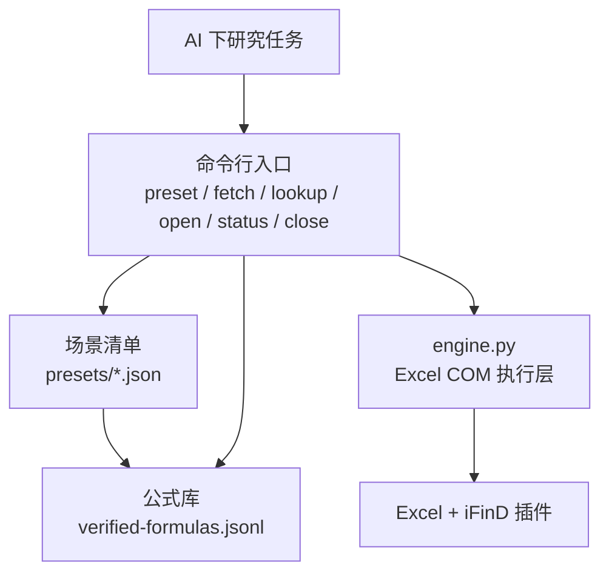

# iFinD场景清单与字段组方案（2026-11-23）

状态：讨论稿，待用户确认后实施。本轮只做原型验证与库标注，未改动生产代码。

本方案只维护「场景清单 / 字段组」这一层。指标级取数命令fetch的入参、参数填充、全零告警、lookup改造等设计，见[CLI重构方案](iFinD-Excel-CLI重构方案-2026-11-20.md)，此处不重复。

## 一、为什么需要这一层

用户的研究任务里反复出现同一类要求：查工商信息要二十多个字段、查十大股东要整张披露表、查行情不要每次说区间和复权。这些需求的共同点是「要哪些数据」可以提前写定，与「怎么取数」无关。

把这类要求写死在CLI代码里会让每个新场景都改程序，改程序就有改坏其他场景的风险。写成数据文件则只增加文件，程序一行不动。

分界（2026-11-23用户确认）：不需要加工的数据做成场景清单文件；需要加工的由AI临时写程序，用完删掉。基础CLI只放取数、开关Excel、查询公式这些通用能力，不放任何具体场景。

## 二、三个层次



| 层 | 职责 | 改动频率 |
|---|---|---|
| 场景清单 | 要哪些字段、什么规则、什么默认值 | 随研究需求增加 |
| 命令行入口 | 展开、取数、合并、错误处理 | 极少改 |
| 公式库 | 指标码、模板、单位、备注 | 随指标补录 |
| engine.py | COM、分块、超时、存活 | 本次不动 |

## 三、场景清单格式

三个字段位依次是 `label`（输出列名）、取值来源、可选规则。

### 3.1 普通字段

一个指标对应一个列：

```json
{
  "label": "总资产",
  "indicator": "ths_total_assets_stock"
}
```

### 3.2 多候选字段

一个列名对应多个候选指标，按规则选一个。固定资产、在建工程属于此类：

```json
{
  "label": "固定资产",
  "pick": "max",
  "candidates": ["ths_fixed_asset_stock", "ths_fixed_asset_sum_stock"]
}
```

`pick` 首版只实现 `max`。理由见第四节。

### 3.3 表格维度

一个字段对应多个名次或日期，需要额外的维度定义：

```json
{
  "name": "十大股东",
  "dims": {"rank": [1, 2, 3, 4, 5, 6, 7, 8, 9, 10]},
  "fields": [
    {"label": "名称", "indicator": "ths_holder_name_stock"},
    {"label": "性质", "indicator": "ths_holder_nature_stock"},
    {"label": "持股数", "indicator": "ths_holder_held_num_stock"},
    {"label": "持股比例", "indicator": "ths_holder_held_ratio_stock"}
  ]
}
```

维度值除显式列举外，还需支持区间展开。历史行情用日期区间作为维度，默认值由清单里写定。

### 3.4 场景级默认值

用户不必每次说区间和复权。默认值写在清单里：

```json
{
  "name": "历史行情",
  "defaults": {"start": "2016-01-01", "end": "today", "adjust": 108},
  "fields": [
    {"label": "收盘价", "indicator": "ths_close_price_stock"},
    {"label": "总市值", "indicator": "market_value"}
  ]
}
```

`adjust` 的取值是iFinD复权枚举，108为前复权（2026-11-23用户确认，实测最新交易日不复权与前复权同为1485.75，历史值向下调整，符合前复权定义）。

## 四、多候选字段的取值规则

### 4.1 规则

同时取全部候选，取其中较大的数值。零值自然被排除。

### 4.2 为什么取较大值而不是按报告期或公司类型分流

两个科目的可用性受两个因素影响，且方向相反：

| 情形 | 单项科目 | 合计科目 |
|---|---|---|
| 季报（3月末、9月末） | 返回0 | 有值 |
| 金融类公司 | 有值 | 返回0 |
| 非金融年报、中报 | 有值 | 与单项相同 |
| 重资产公司在建工程 | 较小 | 较大（含工程物资） |

若按条件分流，需要先判断公司类型和报告期，判断逻辑本身会成为新的出错点。取较大值不需要任何判断，四种情形一次覆盖。

前提是「合计不小于单项」，这一点已实测。

### 4.3 会计依据

财政部的报表格式修订规定了强制归并：

| 文号 | 规定 |
|---|---|
| 财会〔2018〕15号 | 删除「工程物资」项目，归并至「在建工程」 |
| 财会〔2019〕6号 | 删除「固定资产清理」项目，归并至「固定资产」 |

因此合计科目是资产负债表对外披露的口径，单项是明细口径。二者差异来自科目归属，不是口径摇摆，取较大值不会造成金额重复或遗漏。

### 4.4 实测证据

| 科目 | 样本 | 合计小于单项 | 勾稽检验 |
|---|---|---|---|
| 固定资产 | 20公司3年期共180式 | 0条 | 合计减单项等于固定资产清理，长江电力2024年差15656716元、2025年差13769793元完全吻合 |
| 在建工程 | 20公司3年期年报60样本、5公司5期季报中报25样本、另30个重资产年报样本 | 0条 | 季报仅合计有值、金融公司仅单项有值两种情形均由max正确选中 |

样本覆盖的差异实例：

| 公司 | 期间 | 单项 | 合计 | 差异 |
|---|---|---|---|---|
| 比亚迪 | 2024-12-31 | 131.70亿 | 199.54亿 | 67.84亿 |
| 万华化学 | 2025-12-31 | 311.12亿 | 346.25亿 | 35.13亿 |
| 海螺水泥 | 2023-12-31 | 87.34亿 | 108.42亿 | 21.08亿 |
| 紫金矿业 | 2024-12-31 | 386.01亿 | 400.55亿 | 14.53亿 |

实测情况已写入公式库四个科目各自的notes，此处只记结论，逐条明细不重复维护。

### 4.5 零值处理

两个候选同时为0时即为0，程序不做特殊判断、不加告警、不重试。理由（2026-11-23用户确认）：不假设iFinD在正常的零资产情形下漏采。

## 五、程序实现

### 5.1 三步


1. 展开：每个字段的每个候选各占一列，每行一个代码或期间。走与fetch同一套占位符替换逻辑。
2. 取数：一次提交矩阵，沿用engine的2500行分块、超时、错误单元格上报。
3. 合并：按 `pick` 规则选出值，同时记录选了哪个候选、被弃候选的值是多少。

原型已在 `.codex-temp/` 内验证通过，三类场景均正确：

| 公司 | 期间 | 固定资产 | 在建工程 | 选择情况 |
|---|---|---|---|---|
| 贵州茅台 | 2025-09-30 | 211.71亿 | 35.35亿 | 季报单项为0，选中合计 |
| 工商银行 | 2024-12-31 | 2793.94亿 | 211.17亿 | 金融公司合计为0，选中单项 |
| 万华化学 | 2025-12-31 | 1569.06亿 | 346.25亿 | 合计更全，选中合计并弃311.12亿 |

### 5.2 输出必须带选择记录

多候选字段的取值在候选间不同时，结果需带出选了哪个、弃了多少，否则后续与其他工具对数值时无法解释差异。

两值相同时不出这条记录，避免正常数据被冗余说明淹没。

### 5.3 命令形态

| 命令 | 用途 |
|---|---|
| `preset` | 按场景清单取数，入参为清单名加代码与可选期间 |
| `fetch` | 按指标码或名取数，不做场景封装 |
| `lookup` | 查公式库 |
| `open` / `status` / `close` | Excel存活 |

`preset` 与 `fetch` 共用展开与参数填充逻辑，只是入参来源不同。指标级设计见[CLI重构方案第五节](iFinD-Excel-CLI重构方案-2026-11-20.md)。

## 六、第一批场景

依据是用户现有研究任务：单公司研究模板的十六个工作表结构、光模块与存储芯片课题、半导体设备九家的取数方式。六个场景全部有现成指标支撑，不需要新增插件原文。

| 场景 | 内容 | 库支撑 |
|---|---|---|
| 工商信息 | 公司名、注册资本、法人、地址、行业、员工、上市信息、高管等 | 基本资料69条 |
| 十大股东 | 7字段乘10名次完整披露表 | 指标实测有效，待入库 |
| 历史行情 | 开高低收、成交、总市值 | 行情与市值指标齐全 |
| 估值快照 | PE、PB、总市值、流通市值 | 齐全 |
| 三表全表 | 资产负债表155条、利润表92条、现金流量表118条 | 齐全 |
| 单季报表 | 利润表单季109条、现金流量表单季114条 | 齐全 |

明确不进第一批：

- 衍生指标（毛利率、ROE、资产负债率、三个增长率）：用户决定先不管。
- 分产品、分地区收入，客户与供应商集中度：已验证库无对应指标，需iFinD表格型接口，与公式矩阵不是同一形态，继续走market-data。
- 十大股东的7个指标尚未入库，需先补库。

## 七、实施顺序

| 阶段 | 内容 | 验收 |
|---|---|---|
| S1 | 建presets目录与工商信息一份清单，CLI增加preset命令（只支持普通字段） | 一句话取回工商信息二十余字段 |
| S2 | 支持表格维度 | 十大股东一次取回7字段乘10名次 |
| S3 | 支持多候选与max规则 | 固定资产与在建工程在季报、金融公司、重资产公司三类场景均取到正确值，且带选择记录 |
| S4 | 支持日期区间维度与场景级默认值 | 历史行情只传代码即返回2016年至今前复权序列 |
| S5 | 补齐其余五个场景 | 六个场景全部可用 |

S3依赖公式库先补股东指标，与S2同批处理。

## 八、待确认

1. 本方案是否作为实施依据。
2. S1至S5一次做完还是分批验收。
3. 十大股东7个指标未入库，是否按实测结果补录（实测茅台2024十大股东4字段乘10名次全部取回，集团54.07%、香港中央结算6.17%与年报一致）。

## 九、相关

- 指标级取数设计：[iFinD Excel CLI重构方案](iFinD-Excel-CLI重构方案-2026-11-20.md)
- 公式库字段与写入纪律：[公式库说明](../src/ifind_excel_tool/formula_library/README.md)
- 建设背景：[iFinD公式验证库建设方案](iFinD公式验证库建设方案-2026-11-18.md)
- 源码：`src/ifind_excel_tool/cli.py`、`engine.py`
