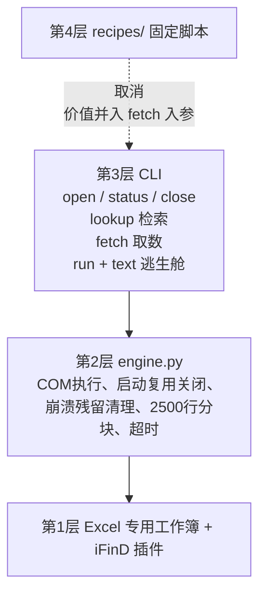

# iFinD Excel CLI重构方案（2026-11-20）

状态：讨论稿，待用户确认后实施。本轮只读检查与实测核对，未改动任何代码或库文件。

## 一、问题本质

现工具是公式工作台，交互中心是「公式」。使用者的需求中心是「取数」。所有摩擦都是这一个错配的外化：

- 检索靠子串匹配，查「归母净利润」只命中 `pe_ttm`（definition正文里有这五个字）。
- 查到的是带 `{code}/{date}/{type}` 占位符的模板，还得自己替换、自己拼矩阵。
- engine返回裸二维数组，字段名靠行号对位，单位要回查lookup。
- 语义错（代码格式错、字段与市场不匹配、报告期非披露期）一律返回0，`errors` 是空数组，`ok` 是true。
- `engine.status()` 已实现但CLI没暴露，Excel打不开时无从判断。

改造目标：AI给「代码 + 指标 + 期间」，直接拿到带单位、带口径、带实际公式的结果。

## 二、实测核实的事实

| 项目 | 事实 | 来源 |
|---|---|---|
| 已验证公式 | 753条：verified 637、verified_with_caveat 116 | verified-formulas.jsonl |
| 未验证索引 | 30281条，只作查漏 | catalog.jsonl |
| 别名覆盖 | 仅3条有aliases | 同上 |
| 占位符组合 | 16种；A股标准形态 `code+date+type` 506条 | 同上 |
| 无法自动填参 | 149/753条（currency+type 82、type 26、currency 14等） | 按default判定 |
| Type参数含义 | 按指标族而异：财报类是报表类型，行情类是复权方式 | 逐条读parameters |
| Type=100通用性 | 财报族=合并报表、行情族=不复权，全族安全 | 同上 |
| status已实现 | engine.status() 只读、0.37秒、未打开不启动Excel | engine.py:167 |
| CLI暴露面 | 仅lookup/run/text/close四命令，94行 | cli.py |
| 分块粒度 | ROWS_PER_BATCH=2500行/批 | engine.py:24 |
| recipes目录 | 存在但为空 | 实测ls |

## 三、结构决策：取消第4层

用户原始设想是四层：Excel / 基础py脚本 / 核心CLI / 专门脚本。结论是取消第4层，收敛为三层。

理由不是「CLI够通用所以能合并」，而是第4层原本承载的东西都能在下面两处解决：



用户已确认的需求边界（2026-11-20原话）：

- 长历史行情只用于单个公司：2016年至今收盘价、总市值，约2400-4800式，engine分2批，量级在几秒。
- 全市场只取今天截面：全市场 × 少几十个变量 × 一期。
- 明确不做全市场 × 全时期 × 全指标的一次性大范围获取（需要时用户自己处理）。
- 跨步骤依赖灵活处理，不固化成脚本。

三类需求都可以表达成同一个笛卡尔积 `codes × indicators × periods`：

| 需求 | 展开 | 批数 |
|---|---|---|
| 单公司历史行情 | 1码 × 2指标 × 2400期 = 4800式 | 2批 |
| 全市场今日截面 | 5000码 × 几十指标 × 1期 | 数十批 |
| 跨步骤组合 | AI编排两次fetch | — |

没有第四类。既然不存在固定脚本能表达而fetch表达不了的场景，第4层就没有承载物。

### 为什么不走区间行情指标

catalog有28条「区间行情」类目标（股票、指数、港股、全球股票等各有一组），已验证库一条都没有。用区间指标取长历史本可1式代替2400式，但：

- 按铁律，iFinD参数严禁猜测，需要用户提供插件原文才能录入。
- 用户的长历史需求只针对单公司，4800式engine扛得住，收益不足以支撑一次库扩充。
- 全市场只取今天截面，也不需要区间。

结论：暂不补区间指标。若将来出现多公司 × 长区间需求，再补库并让fetch增加range展开。

### 第5点「AI知道有哪些固定脚本」的替代

取消recipes后，对应能力改为两条：

1. fetch的常用请求示例，随工具README和Skill维护（不是代码目录，无需发现机制）。
2. lookup是唯一的能力发现入口，返回全部已验证指标的可检索视图。

## 四、CLI目标形态

七个命令，全部stdin JSON → stdout JSON：

| 命令 | 作用 | 现状 |
|---|---|---|
| `open` | 打开或复用专用工作簿，保持常驻 | engine有，CLI未暴露 |
| `status` | 只读状态：opened/pid/visible/read_only/nonempty_cells | engine有，CLI未暴露 |
| `close` | 不保存关闭专用工作簿 | 已有 |
| `lookup` | 检索已验证库 | 已有，需改排序与过滤 |
| `fetch` | 按代码+指标+期间取数，返回带口径的逐条结果 | 新增 |
| `run` | 原始公式矩阵，逃生舱 | 已有 |
| `text` | 文本公式 | 已有 |

`run` 与 `text` 保留为逃生舱：fetch拒绝的模板（参数语义未确认）走run，不做静默降级。

## 五、fetch设计

### 入参

```json
{
  "cmd": "fetch",
  "codes": ["600519.SH"],
  "indicators": ["ths_close_price_stock", "market_value"],
  "periods": ["2024-12-31"],
  "options": {"type": 107},
  "output": "auto"
}
```

- `codes`：证券代码列表。港股位数归一化在CLI做（4位与5位互认，按已实测的0700.HK为准确写）。
- `indicators`：指标码或中文名。见下节匹配策略。
- `periods`：报告期末日或交易日列表，`YYYY-MM-DD`。
- `options`：可选，按参数名覆盖默认值（如复权 `type`）。
- `output`：`auto`（默认）/`json`/`csv`。

### 指标匹配策略（2026-11-20定为技术细节，由实现决定）

顺序：`indicator` 精确 > `name` 精确 > `aliases` 精确 > 唯一子串命中。命中唯一才取数；零命中或多命中都在error里带出候选清单（indicator/path/unit/verification），由AI挑。不静默取第一条。

理由：750条无别名是既成事实，靠补别名解决是额外工作量且别名质量决定正确性；「唯一才取、歧义列候选」零别名即可用，代价只是首次多一轮。

### 参数填充

对每条记录按 `formula_template` 的占位符填参：

| 占位符 | 来源 | 缺省处理 |
|---|---|---|
| `{code}` | codes | — |
| `{date}` | periods | — |
| `{type}` | 记录parameters的default；无default时用100 | 100在财报族=合并报表、行情族=不复权，全族安全 |
| `{currency}`/`{unit}`/`{level}`/`{basis}`/`{index}`/`{year}`/`{quarter}`/`{employment}` | 记录default | 无default则拒绝该条，回落run |

149/753条属无default情况，其中82条是 `currency+type`。这类模板在fetch里明确拒绝并给出原因，不猜。

币种例外：港股/全球股票的unit标「元」，实际随currency参数变化，是真实口径错配风险。fetch结果必须回显实际填入的currency与unit。

### 出参

小结果走stdout JSON，逐条带元数据；大结果落CSV并返回路径。阈值实现时定，取向是避免把几十万条记录塞进AI上下文。

每条记录：

```
code / period / indicator / name / value / unit / verification / notes / general_notes / formula
```

- `verification=verified_with_caveat` 的记录强制带 `notes`，不省略。
- `value` 区分三态：数值、null（上游无值）、error（单元格报错）。全0单独给warnings，不混入errors。

### 全零告警

语义错返回0是本工具最严重的正确性风险（实测：A股字段+港股代码、港股字段+A股代码、5位港股码、非法日期、不存在代码、未上市期 均返回0且errors为空）。

fetch增加 `warnings` 分级：

| 级别 | 触发条件 | 提示方向 |
|---|---|---|
| 整批全0 | 所有记录均为0 | 代码格式、字段与市场是否匹配、报告期是否已披露 |
| 单行全0 | 同批其他行有值 | 该代码该期的覆盖情况 |
| 代码全0 | 某代码所有指标为0 | 代码是否有效、是否未上市 |

不自动重试、不静默换源。

## 六、lookup改造

排序优先级：`name` 精确 > `name` 包含 > `indicator` 精确 > `aliases` > `definition`（definition命中排末尾并标注「仅定义命中」）。

新增：

- 返回 `reading_mode`（676 matrix / 77 text），现在漏了，导致AI不知道文本字段要走text命令。
- 市场过滤（A股/港股/美股/全球股票/指数/外汇，按path顶层分组）。
- 累计/单季过滤（按path中的「单季度」）。
- 差额/特殊/合计平衡类科目默认降权。
- 分页，不再 `hits[:limit]` 直接截断。

## 七、错误处理

- `main()` 顶层try包住 `json.loads`，非法JSON返回 `{"ok":false,"error":...}` 而不是Python堆栈。
- 统一错误分类：请求错误 / Excel不可用 / 单元格失败 / 参数未确认 / 指标歧义。

## 八、实施顺序

| 阶段 | 内容 | 验收 |
|---|---|---|
| P0-1 | CLI暴露open/status，main顶层try | 任意目录、坏JSON、未开Excel三种情况都返回结构化JSON |
| P0-2 | lookup排序、reading_mode、市场与累计/单季过滤、分页 | 「归母净利润」「净利润」「营业收入」三词的命中顺序符合预期 |
| P0-3 | fetch命令 | 600519.SH两期营收+归母净利润，一次调用拿到4条带单位与口径的记录，抽1条回公告核对 |
| P1 | 全零告警、CSV落盘、币种回显 | 用实测过的6种静默0场景逐一验证能告警 |
| P2 | README与Skill环境描述修正（实际不需要PYTHONPATH和仓库根目录）、market-data退役清单 | 从任意目录直接跑通 |

## 九、待确认

1. 本方案是否作为实施依据。
2. P0三阶段是否一次做完还是分批验收。

## 十、相关

- 既有评估：mnemon文档 `851f571a-ebc2-4392-be56-c5c4facc90d2`、`17aebe39-021d-42fe-bd27-a8169c1ced06`、`5c5bd537-f80b-44e6-9857-08906247fbf6`
- 建设方案：[iFinD公式验证库建设方案](iFinD公式验证库建设方案-2026-11-18.md)
- 源码：`src/ifind_excel_tool/cli.py`、`engine.py`、`formula_library/README.md`
