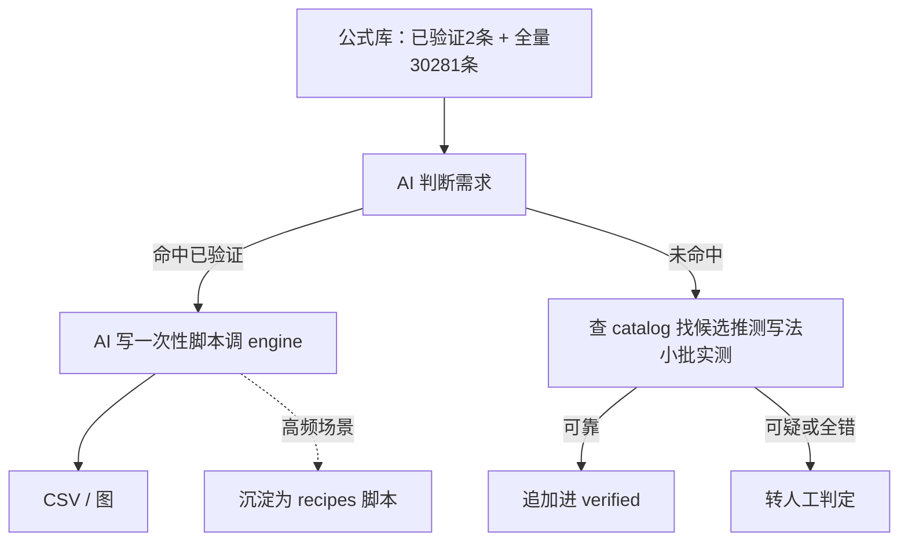

# iFinD Excel 公式验证库建设方案（2026-11-18）

已实施。本文件记录目标、库结构、使用流程与首批归位；现行入口见包说明（../src/ifind_excel_tool/README.md），字段定义见库说明（../src/ifind_excel_tool/formula_library/README.md）。本次只新增 ifind_excel_tool 包与本文档、更新 AGENTS 导航；未改 market-data、公告侧、脑图、用户版，未导出、未推送。

## 一、目标与定位

把 iFinD Excel 插件取数能力从「market-data 固定工具 + 字段白名单」改为「公式库驱动 + AI 随用随开发」的取数工作台。AI 需要任何数据时先查公式库拿已验证写法，再写一次性脚本调执行层取数；只有高频场景才沉淀为固定脚本。

ifind_excel_tool 与公告 MCP、market-data MCP 平级，纯 CLI，对旧包零 import 依赖。market-data 保留美股行情、证券搜索、绘图、SDK 公司信息等独有能力；两边暂并行，后续再定合并或独立。

复用边界：engine.py 从 market_data_mcp/ifind_excel.py 复制（该模块本就无 MCP/CLI/SDK/业务缓存依赖，工作簿按自身路径定位）；已验证的错值反例与口径事实以数据形式迁入 JSONL，不通过代码依赖。

## 二、为什么必须分两层

以下均为本项目内实测或已确认事实，决定库不能只做「有/无」两态。

| 事实 | 证据 | 对库的要求 |
|---|---|---|
| 参数位序不可推导 | 按「2+Type个数」取参命中率11.5%，无规则基线11%；日期在第2位100次、末位36次、不用7次；按文档原序22样本0命中 | 存完整公式模板与参数位置，不只存指标码 |
| 错参数静默返回错值 | ths_close_price_spot(USDX)返回25.71，美元指数应在100附近；ths_pe_index 多一参返回0 | 必须有示例值和验证状态 |
| 文档正确但数据错 | 复权码106在2015-06-01返回-55.02；ths_market_value_stock 在2015-2021各日期返回同一固定值 | 验证状态要能区分「有附加条件」 |
| 存在第二套短名体系 | close_price、pe、average_price 均可调用，说明库有4979条非 ths_ 前缀 | 要有 aliases 字段支持别名检索 |
| 文本与数值分通道 | 股票简称返回文本走 text_ok=True 单列；总股本返回数值走 matrix | 要有 reading_mode 字段决定执行通道 |
| 全量大批实测会超时 | 120指标约1900公式一次性提交，fetch_matrix 超过500秒被终止 | 推测实测必须小批进行，带超时和重置 |
| UI路径不在说明库里 | 30281条中仅2214条带 _同花顺函数库_ 路径 | path 列为人工字段，按插件树填写 |

## 三、文件树与库形态

```text
src/ifind_excel_tool/
├── engine.py                    # 执行层，复制自 ifind_excel.py，零旧包依赖
├── cli.py                       # 极薄入口：lookup / run / text
├── README.md                    # 包说明与随用随开发流程
├── data/ifind_workspace.xlsx    # 专用工作簿
├── formula_library/
│   ├── verified-formulas.jsonl  # 已验证记录，只追加，仅用户确认来源
│   ├── catalog.jsonl            # 全量30281条，脚本生成
│   ├── build_catalog.py         # 从 excel_description.dat 生成 catalog
│   ├── gen_verified.py          # 首批已验证记录的生成脚本，留作审计
│   └── README.md                # 字段定义与转入规则
└── recipes/                     # 高频场景脚本，初期为空
```

采用 JSONL 而非嵌套目录：每条记录自包含，追加时 git diff 清晰，检索按 path 前缀过滤，效果与插件树一致。

### 单条记录字段

| 字段 | 含义 | 来源 |
|---|---|---|
| path | 插件函数搜索树路径，斜杠分隔 | 人工按插件树填 |
| name / aliases | 中文名与别名，用于检索 | 说明库或人工 |
| indicator | 指标码 | 说明库 Formula 段 |
| formula_template | 带 {code}/{date} 占位符的完整公式 | 实测定 |
| definition / algorithm | 定义与算法原文 | 说明库 |
| parameters | 数组，每项 position/name/meaning/options/default | 说明库枚举 + 实测位序 |
| source / unit | 来源与单位，原文为空则留空 | 说明库 |
| example / example_value | 示例公式与实测值 | 实测 |
| verification | verified 或 verified_with_caveat | 判定 |
| verified_at / evidence | 验证日期与证据出处 | 判定 |
| notes | 口径限制、错值反例、别名关系 | 人工 |
| reading_mode | matrix（数值）或 text（文本，走 text_ok=True） | 实测 |

parameters 示例：{position: 2, name: thsCode, meaning: 证券代码, options: []}。静态字段（如股票简称）只有 position 2，无 {date} 占位符。

### 验证状态

| 状态 | 含义 | AI 行为 |
|---|---|---|
| verified | 示例值正确，无附加条件 | 直接用，返回原值 |
| verified_with_caveat | 公式与示例正确，但有口径限制、历史区间限制或参数含义未确认 | 返回数据时必须带出 notes 提示 |

只有这两级进库，未验证一律不进。

## 四、怎么用



CLI 只有三个命令：lookup（按关键词查已验证库）、run（数值公式矩阵，走 fetch_matrix）、text（文本公式，走 fetch_formulas text_ok=True）。AI 写一次性脚本时直接 import engine，不经 CLI。

判定可靠的操作标准：返回非空非零且量级合理；同指标已知样本横比一致；参数取值在说明库枚举内。不满足任一条即标可疑，不自动入库。若推测实测全错，放弃该推测并告知需重新检查公式，不反复试错。

## 五、首批归位与 2026-11-18 清除事件

首次建库时写入40条，其中只有2条来自用户从 iFinD 插件界面亲自提供的描述与示例值，其余38条的 path/name/source/unit 由 AI 按理解填写或从 catalog.jsonl、2018手册、历史仓库推测，属于不可靠来源。

用户明确要求以 iFinD 插件实际结果为准、库里宁可少不能错后，38条已全部清除，correction-log.jsonl 记录了此次清除；库现仅保留2条用户确认记录：

| path | name | indicator | example_value |
|---|---|---|---|
| 股票全部指标/股本结构 | 总股本 | ths_total_shares_stock | 1177909641 |
| 股票全部指标/基本资料/证券资料 | 股票简称 | ths_stock_short_name_stock | 中际旭创 |

清除原因与教训已写入 AGENTS 铁律第9条、formula_library/README.md「数据来源等级」。catalog.jsonl 保留作查漏候选，但严禁用来核对或覆盖已验证库。
## 六、验证方式

- 结构验证：每条记录字段齐全，formula_template 占位符与 parameters 位置一致（已通过）。
- 检索验证：按名称、别名、指标码、path 四类关键词各测一轮（lookup 已通过）。
- 取数验证：verified 记录逐条执行 example 比对 example_value，不一致即降级或退出库（待逐条跑）。
- 不验证项：caveat 记录的参数含义、财报未实测写法，只做结构检查，不声称取数通过。