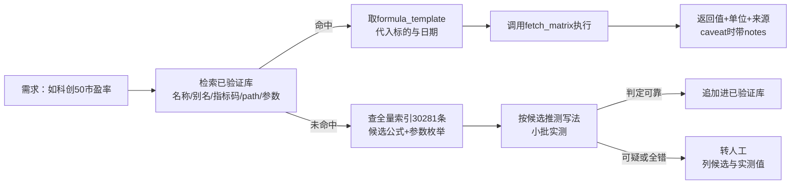

# iFinD Excel 公式验证库建设方案（2026-11-18）

执行稿，待用户确认后实施。本稿只定义库结构、字段、使用流程和首批归位清单，不含实施代码。

## 一、目标与边界

目标：建立一个按 iFinD 插件函数搜索树 path 归类的「已验证公式库」。AI 需要数据时先查这个库，命中就拿现成公式模板拼公式执行；未命中的公式留在全量索引，经推测、实测、判定可靠后才转入已验证库。

双层结构：

| 层 | 内容 | 规模 | 用途 |
|---|---|---:|---|
| 已验证库 | 有示例值、有证据、有验证状态的公式 | 首批约45条 | AI 优先检索，直接取数 |
| 全量索引 | 插件自带函数说明库 | 30281条 | 查漏、推测候选公式 |

边界：

- 只新增方案文档，本稿不实施建库、不注册 MCP、不改 CLI、不改缓存、不改现有 provider。
- 不改 Xmind、字段与数据源支持情况、决策记录、架构设计、脑图或其他现行文档。
- 不导出用户版、不推送、不碰工作区中其他会话的改动（Xmind、ifind_workspace.xlsx、ifind_excel.py、港股方案稿、PDF）。

数据依据：

- 插件自带 `C:\Program Files\iFinD\etc\datacube\excel_description.dat`，SQLite，30281 行，每行含定义、算法、参数枚举、来源、单位五段。这是当前版本插件的明文数据，优先于 2018 年 PDF 手册。
- 全量索引由该文件生成，PDF 索引（`reference/ifind-Excel公式索引-20181218.jsonl`，10777 码）只作历史备选，不作为当前插件能力依据。

## 二、为什么必须分两层

以下几项均为本项目内实测或已确认事实，决定库不能只做「有/无」两态。

| 事实 | 证据 | 对库的要求 |
|---|---|---|
| 参数位序不可推导 | 按「2+Type个数」取参命中率11.5%，无规则基线11%；日期在第2位100次、末位36次、不用日期7次；按文档原序22个样本0命中 | 已验证记录必须存完整公式模板与参数位置，不能只存指标码 |
| 错参数静默返回错值 | `ths_close_price_spot`（USDX）返回25.71，美元指数应在100附近；`ths_pe_index` 多一参返回0 | 必须有示例值和验证状态，不能把「能返回数」当成功 |
| 文档正确但数据错 | 复权码106在2015-06-01返回 -55.02；`ths_market_value_stock` 在2015-2021各日期返回同一固定值 | 验证状态要能区分「有附加条件」 |
| 存在第二套短名体系 | `close_price`、`pe`、`average_price` 均可调用，说明库中有4979条非 ths_ 前缀记录 | 库要有 aliases 字段支持别名检索 |
| 全量大批实测会超时 | 120个指标约1900个公式一次性提交，`fetch_matrix` 超过500秒被终止 | 推测实测必须小批进行，带超时和重置 |
| UI路径不在说明库里 | 30281条中只有2214条带 `_同花顺函数库_` 路径，其余28063条无路径 | path 列为人工字段，按插件树填写 |

## 三、库的形态

### 3.1 文件与分组

建议新建 `formula-library/` 目录：

| 文件 | 内容 | 维护方式 |
|---|---|---|
| `verified-formulas.jsonl` | 已验证公式，每行一条记录 | 只追加经确认的记录 |
| `catalog.jsonl` | 全量索引，由 excel_description.dat 生成 | 脚本重新生成，不手工编辑 |
| `README.md` | 字段定义、检索方法、转入规则 | 人工维护 |

采用 JSONL 而非嵌套目录：每条记录自包含，追加时 git diff 清晰，检索时无需展开层级。按 path 分组通过「写入时按 path 排序、同 path 相邻」实现；检索时按 path 前缀过滤，效果与插件树一致。

未验证公式不写入 `verified-formulas.jsonl`，只存在于 `catalog.jsonl`。

### 3.2 单条记录字段

以用户给出的总股本条目为原型，把「说明」中的混合文本拆成独立字段，便于按名称、参数、枚举检索。

| 字段 | 类型 | 含义 | 来源 |
|---|---|---|---|
| path | string | 插件函数搜索树路径，斜杠分隔，如 `股票全部指标/股本结构` | 人工按插件树填 |
| name | string | 中文名，如 `总股本` | 说明库定义段或人工 |
| aliases | array | 别名，支持检索 | 人工 |
| indicator | string | 指标码，如 `ths_total_shares_stock` | 说明库 Formula 段 |
| formula_template | string | 带 `{code}`、`{date}` 占位符的完整公式 | 实测确认的写法 |
| definition | string | 定义原文 | 说明库定义段 |
| algorithm | string | 算法原文 | 说明库算法段 |
| parameters | array | 每项含 position、name、meaning、options、default | 说明库参数段 + 实测位序 |
| source | string | 数据来源，如 `公司公告` | 说明库来源段 |
| unit | string | 单位，如 `股` | 说明库单位段 |
| example | string | 可直接执行的示例公式 | 实测 |
| example_value | number/string | 示例返回值 | 实测 |
| verification | enum | `verified` 或 `verified_with_caveat` | 判定 |
| verified_at | date | 验证日期 | 判定 |
| evidence | string | 证据出处，如文档章节或实测报告 | 判定 |
| notes | string | 补充说明、口径限制、别名关系、错值反例 | 人工 |

`parameters` 示例结构：

```json
{"position": 2, "name": "thsCode", "meaning": "证券同花顺代码或交易代码", "options": null}
{"position": 3, "name": "Date", "meaning": "日期，不设则默认本机系统日期", "options": null}
```

### 3.3 验证状态

| 状态 | 含义 | AI 行为 |
|---|---|---|
| verified | 示例值正确，无附加条件 | 直接用，返回原值 |
| verified_with_caveat | 公式与示例正确，但有口径限制、历史区间限制或需区分口径 | 返回数据时必须同时带出 notes 提示 |

设两级的原因：复权码106和市值固定值都属于「文档对、数据错」，B股成交额币种属于「有口径条件」。这些记录有参考价值但不能当无条件真值。只有这两级进库，未验证一律不进。

## 四、怎么用



「判定可靠」的操作标准：

1. 返回非空、非零，且为该指标合理量级（如指数PE在个位数至数百之间，股本以亿计，汇率在合理区间）。
2. 与同指标已知样本横比一致（如同一 PE 指标换另一个指数，结果应同量级）。
3. 所用参数取值落在说明库枚举范围内。
4. 不满足任一条即标为可疑，不自动入库，把候选公式和实测值列给用户判定。

用户补充规则：若推测实测全错，放弃该推测并明确告知「需重新检查对应公式」，不反复试错消耗额度。

## 五、首批归位清单

### 5.1 第一批：可进库，状态 verified

来源为 Xmind「行情数据」分支注释中的原式与历次实测报告，约45条，按 path 归类：

| path | 指标 |
|---|---|
| 股票全部指标/行情指标 | 开高低收 `ths_open_price_stock`、`ths_high_price_stock`、`ths_low_stock`、`ths_close_price_stock`；后复权收 `close_no_forward`；均价 `ths_avg_price_stock`；成交额 `ths_amt_stock`；换手率 `ths_turnover_ratio_stock` |
| 股票全部指标/股本结构 | `ths_total_shares_stock`、`ths_total_ashare_stock`、`ths_total_bshare_stock` |
| 股票全部指标/市值指标 | `ths_mv_sec_oriented_stock`、`ths_mv_back_test_stock` |
| 港股全部指标/行情指标 | `ths_open_price_hks`、`ths_high_d_hks`、`ths_low_d_hks`、`ths_close_price_hks`、`ths_avg_price_hks`、`ths_amt_d_hks`、`ths_turnover_ratio_hks` |
| 港股全部指标/股本市值 | `ths_corp_total_shares_hks`、`ths_sec_total_shares_hks`、`ths_market_value_hks`、`ths_totalcapitalforsecurities_hk` |
| 股票全部指标/基本资料 | `ths_ipo_date_stock`、`ths_listing_exchange_stock`、`ths_stock_varieties_stock` |
| 港股全部指标/基本资料 | `ths_ipo_date_hks` |
| 外汇全部指标 | `ths_closef_forex`（别名 `ths_close_forex`，两者同值） |
| 指数全部指标 | `ths_pe_index`、`ths_pb_index`、`ths_ps_index`、`ths_dividend_rate_index`、`ths_close_price_index`、`ths_ma_index`、`ths_rsi_index` |
| 美股全部指标/股本指标 | `ths_float_shares_usk` |
| 短名体系 | `close_price`、`pe`、`average_price` |

今日新增实测样本（写入 example/example_value）：科创50 PE=186.22、上证综指 PE=16.58、沪深300 PE=13.81、创业板指 PE=32.87、科创50 PB=6.05、科创50股息率=0.27、科创50收盘=1221.19、茅台总股本=1177909641、USDCNY.IN=6.6655。

### 5.2 第二批：可进库，状态 verified_with_caveat

财报三表328个唯一指标码，来自 `src/market_data_mcp/financial_subjects.py`，含中文名和报表分类，path 对应「财务报表/资产负债表、利润表、现金流量表」。Excel 写法来自模板 `thsiFinD(码,代码,报告期,1)`，未逐个实测，故带 caveat。

### 5.3 不进库

| 资产 | 原因 |
|---|---|
| 公司信息98个指标码（providers 目录） | 走 iFinD SDK 的 THS_BD/THS_DS，不是 Excel thsiFinD，与本库不是同一通道 |
| `ths_market_value_stock` | 虽在脑图有原式，但2015-2021各日期返回同一固定值，属错值；如需保留，只在 notes 中作为反例 |

## 六、实施步骤

1. 建 `formula-library/` 目录与三个文件骨架，字段定义写入 README。
2. 由 `excel_description.dat` 生成 `catalog.jsonl`，保留定义、算法、参数枚举、来源、单位。
3. 按第一节清单写入第一批 verified 记录，path 按插件树人工填写，示例值用已实测样本。
4. 写入第二批财报 caveat 记录，参数按模板写法，notes 标明未逐个实测。
5. 检索自检：用「市盈率」「总股本」「沪市公司总股本」「汇率」「港元兑人民币」等词检索，确认命中符合预期。
6. 更新 AGENTS.md 与架构设计文档的导航入口，只加链接，不复述本稿内容。
7. 本地 Git 提交作为保存点，不推送。

## 七、待确认事项

1. 验证状态采用 `verified` 与 `verified_with_caveat` 两级，还是合并为单一「已验证」、限制全部写入 notes。推荐两级。
2. 库文件位置采用 `formula-library/`，还是放在 `docs/` 或 `src/market_data_mcp/data/`。推荐 `formula-library/`。
3. 用户随后发来的常用公式清单，按本稿字段增量追加，是否需要单独标记来源为「用户直接提供」。

## 八、验证方式

- 结构验证：每条记录字段齐全，`formula_template` 中的占位符与 `parameters` 位置一致。
- 取数验证：对 verified 记录逐条执行 `example`，返回值与 `example_value` 一致；不一致即降级为 caveat 或退出库。
- 检索验证：按名称、别名、指标码、path 四类关键词各测一轮，确认都能命中目标记录。
- 不验证项：未实测的财报 Excel 写法只做结构检查，不声称取数通过。
