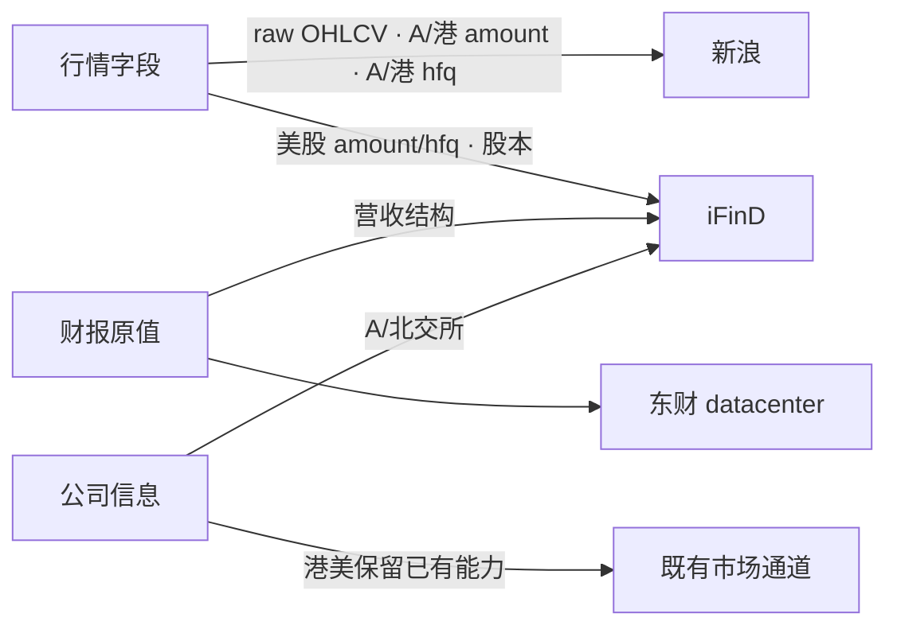
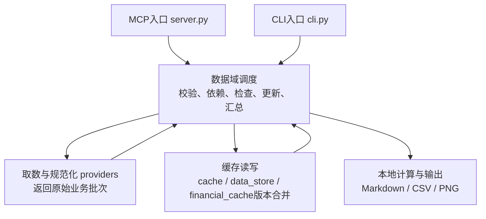
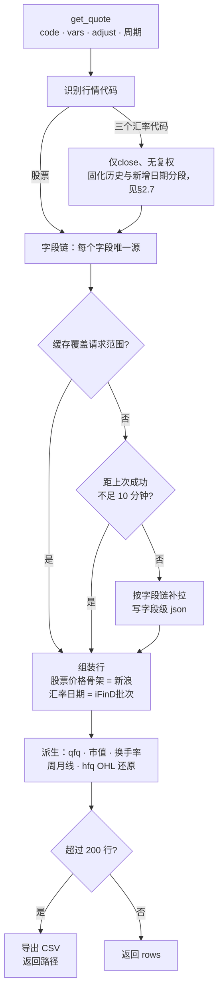
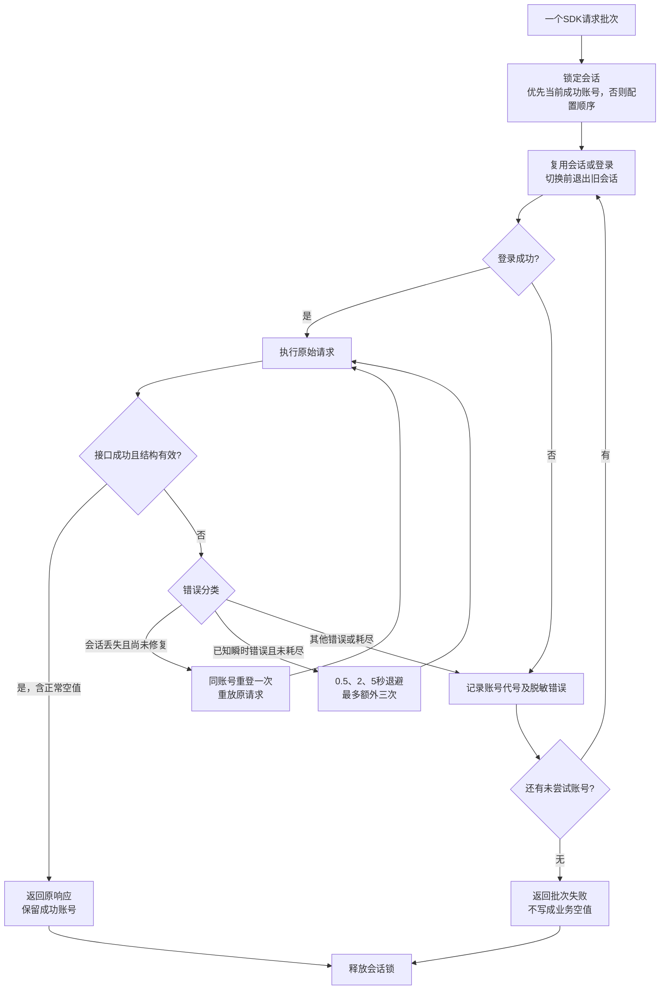

# market-data MCP 架构设计

> **本文件是什么（唯一行为规范）**：market-data MCP 应该是什么样——数据源选择与来源链、复权口径、缓存策略、代码架构、输入输出规范、各工具的行为与边界。要改行为先改这里。
>
> **不写什么**：① 客观上游能力（各源支持哪些市场/字段/参数/返回格式/限制）只在 `字段与数据源支持情况.md`，科目清单在其附件 `ifind财务报表科目.md`；② 变动历史（以前怎样、为什么改）只在 `docs/决策记录.md`；③ 未完成事项与待定项只在 `docs/market-data调整方案稿-*.md`。本文件只引用，不复述。
>
> **子文档**：[`docs/行为-财报工具.md`](行为-财报工具.md)（财报工具的完整行为细则）。图表按 `AGENTS.md` §8 的约定直接内联在正文中。
>
> 本轮已实现行为在本文件及财报子文档维护；待资料与后置事项见[调整方案剩余事项](<market-data调整方案稿-2026-10-23.md>)。

独立 Excel 实验运行层尚未接入现行业务通道，入口与适用边界见[运行说明](Excel常驻运行层.md)，待接入范围见[方案](market-data-Excel常驻取数方案-2026-11-04.md)。
>
> 状态标注：✅ 已定稿　⚠️ 有限　❌ 不做　❓ 待决
> 对应仓库：Ashare-announcements-MCP（与公告 MCP 同仓库，独立包 `market_data_mcp`）。

## 1. 整体定位和说明

### 1.1 功能与定位

四个市场（A股/B股/港股/美股）**结构化数据**获取工具，与公告阅读 MCP（文档层）并列互补：

|          | 公告 MCP（已有）          | market-data MCP（本设计）                                 |
| -------- | ------------------------- | --------------------------------------------------------- |
| 数据类型 | 公告/提交文档（非结构化） | 行情/财报/指标/概况（结构化）                             |
| 数据源   | 东财公告接口 + SEC EDGAR  | 行情来源见§1.4；财报行为仅见§3指向的子文档；公司信息见§5 |
| 消费方式 | 查询/阅读/搜索            | 默认直接返回数据；超长自动导出；指定路径导出              |

个人投资工具。不做汇总文档工具（汇总由用户自己的脚本做）、不做实时行情、不做分钟级数据、不做跨市场科目映射。

### 1.2 工具面

| 工具 | 参数 | 缓存文件 |
| --- | --- | --- |
| `get_quote` | code, vars, adjust, start_date, end_date, period, export_path | **字段级 json**（9 个字段，见 §1.5） |
| `get_quote_chart` | code, adjust, start_date, end_date, period, log_scale, field, events, keypoints, drawdown_threshold | 不写缓存；取数复用 `get_quote`，PNG 落 `cache/_charts/` |
| `get_financial_data` | 完整参数及默认清单见财报子文档 | 独立报表与补充模块，见§3 |
| `get_market_data_help` | tool, market, code, topic | 本地只读能力及缓存查询，见§4 |
| `get_company_profile` | 完整参数及返回见§5 | 类型及时间范围独立缓存，见§5 |

不单设财务比率工具；计算指标归属财报工具。旧工具名不注册为兼容别名。

缓存只存行情 raw+hfq 两份（前复权现算不落盘）+ 股本 shares（市值现算不落盘，见 2.4）。

### 1.3 市场与字段范围

- **市场**：A 股（沪/深/创业板/科创板/北交所）、B 股（沪B/深B）、港股、美股正股及ADR（不做 ETF）。
- **行情字段**：除权价（OHLC）、后复权价（OHLC）、前复权价（OHLC，计算）、成交量、成交额、流通市值、总市值。
- **非行情**：财报三表、财务指标、公司概况/分红/盈利预测。
- 汇率行情另见[§2.7](#27-汇率行情)，不改变上述股票市场的字段逻辑。

### 1.4 数据源体系（决策）

**核心原则（2026-08-08 拍板，2026-11-04 修订总市值）**：字段为中心、来源可插拔；前复权本地计算不依赖源；总市值 A/北交所直取 iFinD（见 §2.4），港美股仍用计算法（股本 × 不复权收盘）。**不按数据源统一排优先级——每个字段有自己的来源链**。

**行情单源化（2026-08-09 定稿）**：除权价与后复权均单源无回退，**避免不同源数据混杂**——后复权跨源口径实测不一致（A股同源比值恒定、港股比值漂移不可混用），混源会把差异带进分析结论。各候选源的限流、覆盖年限与单位问题见 `字段与数据源支持情况.md` §2，退出行情链的过程见 `docs/决策记录.md`，此处不重复。

**来源池角色（决策）**：

| 数据源 | 角色（参与什么） | 不参与什么 | 代理策略 |
| ------ | ---------------- | ---------- | -------- |
| 新浪（AKShare） | **raw 高开低收单源（A/港/美/北交所）**；**A/港股 hfq close 单源** | 美股 hfq（无此能力）、美股 amount（无此能力） | 清代理直连 |
| iFinD | 股本、**A/北交所总市值**、美股后复权收盘与成交额；公司信息见§5；营收结构见财报子文档 | 行情raw/量额（A/港）；港美股总市值（走计算法） | 国内服务，清代理直连 |
| 东财（AKShare） | 财报见子文档；尚未切换的港股公司信息见§5 | 行情raw/hfq、美股amount | 清代理直连 |

未接入来源的客观能力与代理条件见[支持情况§1](../字段与数据源支持情况.md#1-数据源总览)，历史选源变化见[决策记录](决策记录.md)。

**行情字段来源链（2026-08-09 定稿）**：

| 字段 | A/B 股 | 港股 | 美股 |
| ---- | ------ | ---- | ---- |
| open/high/low/close（raw） | **新浪（单源，无回退）** | **新浪（单源，无回退）** | **新浪（单源，无回退）** |
| volume | 新浪 | 新浪 | 新浪 |
| amount | 新浪 | 新浪 | **iFinD 单源**（`amt,OC`：近 5 年 THS_DS 序列 + 更早 THS_BD 单点按交易日历逐日补全） |
| hfq 价格 | **新浪（仅存 close，无回退）** | **新浪（仅存 close，无回退）** | **iFinD THS_DS `107,OC`=分红再投（近 5 年 + 更早单点 THS_BD 补全，全程分红再投）** |
| 股本 | iFinD（§7）；**流通股本=新浪 outstanding_share 维持不切**（2026-10-22 用户拍板：新浪全历史逐日够用，不消耗同花顺额度） | iFinD（§7） | iFinD（§7） |
| 市值 | 计算法：股本 × 不复权收盘（见 2.4），不做直接获取 | 同左 | 同左 |
| 财报与计算指标 | 统一见财报子文档 | 同左 | 同左 |
| 公司信息 | 统一见§5 | 同左 | 同左 |

**图1 字段与数据源归属：每个字段只在链上的一个源取数**



**字段链原则**：链上任一源拿到即填入缓存，全链失败才标注该字段缺失；某字段不稳定只调该字段的链，不动其他字段。选源时先看字段再谈数据源——同一个工具里不同字段可以来自不同源（例如行情 raw 来自新浪、美股成交额来自 iFinD），但不允许同一字段出现两个源的值。

### 1.5 缓存与更新策略

- 缓存存 `cache/{代码}/` 下，JSON 格式 `{meta, items}`：meta 只含 code/market/field/source/updated_at/date_range/shape；**items 为 `[{date, value, source}]`——source 是每条数据的来源追踪标记，每字段同日期仅一条记录（唯一源保证，2026-08-09 用户拍板）**。`date_range` 只记录实际上游数据范围；`updated_at` 记录最近一次成功请求写入时间。旧缓存中的 `verified_until/verified_at/last_probe` 字段不再参与判断，后续写缓存时自然移除。
- **行情缓存为字段级独立 json（2026-08-09 用户拍板）**：高开低收原值 open/high/low/close、后复权 close_hfq（仅 close）、成交额 amount、成交量 volume、总股本 total_shares、流通股本 floating_shares——9 个文件；均为静态历史永不过期。**前复权随分红变动，现算不落盘**。
- **市值现算不落盘**（close.json × 股本字段，逐日前置填充相乘）；股本低频变化，total_shares/floating_shares 月频/日频并存，同源不冲突。
- **行情首次全量、之后增量**：缓存实际范围已覆盖请求范围时直接复用；终点未覆盖但距最近一次成功请求不足固定 10 分钟时短期复用，满 10 分钟再次请求上游。程序不判断盘中盘后、交易所开收盘时间、周末或节假日；上游尚未更新时缓存终点只停在实际拿到的最后日期，不把上游延迟放大到下一自然日。10 分钟为程序硬编码，不增加工具参数。
- 财报缓存、刷新与失败语义仅在[财报子文档](行为-财报工具.md)维护。
- 周/月线由日线现算，不落盘（聚合规则：open=周期首日、high=周期最高、low=周期最低、close=周期末日、volume/amount=周期累计；weekly 用 W-FRI、monthly 用 ME）。

### 1.6 输入输出规范

**股票代码（强制后缀，程序按后缀路由市场）**

| 市场               | 格式       | 示例                              | iFinD 转换              | AKShare 转换 |
| ------------------ | ---------- | --------------------------------- | ----------------------- | ------------ |
| 沪（含沪B/科创板） | 6 位 + .SH | 600519.SH / 900901.SH / 688981.SH | 原样                    | 裸码         |
| 深（含深B/创业板） | 6 位 + .SZ | 000001.SZ / 200725.SZ / 300476.SZ | 原样                    | 裸码         |
| 北交所             | 6 位 + .BJ | 920002.BJ                         | 920002.BJ（实测可用）   | 裸码         |
| 港股               | 5 位 + .HK | 00700.HK                          | 0700.HK（4 位带前导零） | 00700        |
| 美股               | 字母 + .US | AAPL.US                           | 探测 `.O`/`.N`（见 2.2） | AAPL         |

- 后缀大小写不敏感（程序统一处理）。
- **同一个后缀走同一条通道**（如 900901.SH 与 600519.SH 同为沪通道，B 股已实测与 A 股完全同渠道）；**禁止按数字位数/开头猜测市场**（脚本不猜测，AI 负责灵活）。
- 若数据源层提示代码不对，直接报错并给出清晰说明（说明该后缀对应哪个市场、当前源接受的格式），不静默降级重试。

**日期**：`YYYY-MM-DD`。日期起点默认空 = 最近 14 个自然日（含端点，约两周）；日期终点默认空 = 当天系统日期。**`start_date` 特殊值 `"all"`（2026-08-10 增加，为 chart MCP 的全量需求）**：起点不约束——end 留空 = 返回全部数据；end 指定 = 只取 ≤end 的早期数据。返回字段 `start` 显示 `"all"`、`end` 显示 `"latest"` 或指定日期；内部用哨兵起点 `1990-01-01` 触发全量覆盖判定与补拉（数据起点不受此限制，以实际上市/可用为准）。

**返回与导出（2026-08-08 定稿）**：

- `export_path` 空 = **数据直接返回**（rows 数据本体，适合查单日/单周/小范围）。
- 指定 `export_path` = 导出到该路径，返回元信息（路径/条数/范围/单位），不包含 rows。**导出文件格式：CSV**。
- **超长自动导出防护（token 保护）**：未指定 export_path 但返回行数 **> 200 行** → **自动导出到保留位置**（如 `cache/_auto_export/`），返回导出路径 + 元信息 + 提示（阈值 2026-08-08 用户定）。

**币种**：行情、成交额、**市值均为原币**（A 股人民币/港股港元/美股美元；市值 = 股本 × 原币收盘），工具不换汇率；需要其他币种由调用方自行换算（2026-08-08 定：市值币种 = 原始币种）。

market-data的CLI批处理入口按子结果已有ok、status和stale汇总批次status：全部ok=true、status为success或未提供且均非stale时为success；至少一个ok=true且存在部分成功、失败或stale结果时为partial_success；没有ok=true的结果时为failed。各工具内部section仍由所属工具自行汇总，批次不另做递归扫描。

批次requested为请求数量，succeeded仍统计子结果ok=true的数量，failed为其余数量，批次ok仍表示全部子结果ok=true。这些字段反映可用结果口径，status反映完成度；因此全部子结果均有可用数据但其中一项部分成功时，批次可以ok=true、failed=0，同时status必须为partial_success。子结果及其stale等信息原样保留，不新增顶层响应字段。

### 1.7 如何新增

**新增市场**：① 后缀路由表加一行（后缀→渠道）；② 各数据源代码格式转换（iFinD/AKShare 差异表，见数据源文档）；③ 字段表逐列补该市场的来源链；④ 按探测纪律实测各源（一次一小点、带超时、先查接口签名）；⑤ 补测试。

**新增字段/变量**：在字段表定义字段名 + 来源链（或派生计算式，如市值=股本×不复权收盘）→ 链上任一环节成功即有值 → 全链失败标注缺失 → 只动该字段，不影响其他字段。

**新增数据源**：实现可插拔 provider（含代码格式转换、代理策略、复权/频率能力声明）→ 接入各字段链 → 探测验证数据一致性（与现有源逐日对比）→ 补测试。

**维护**：接口签名以 `inspect.signature` 实测为准（akshare 版本升级后复测）；代理差异（国内源清代理直连、yfinance 走代理）见 1.4；NaN 清理必须显式逐值判断（float NaN / pd.NaT 转 None，`df.where(pd.notnull())` 对 float NaN 不生效）。

### 1.8 代码架构（模块化，2026-08-08 讨论定稿）

**图2 代码分层与数据流：入口、调度、取数、缓存、输出、审计**



行情由`service.py`与`aggregator.py`调度，财报由`financial_service.py`调度，公司信息由`company_service.py`与`company_ifind_service.py`调度。取数不直接写业务缓存；只读、计算和help不联网。每次上游请求的审计日志不参与业务判断。

**三层结构，像拼积木一样组合**：

```
请求模块（叶子）：入参=标准代码+日期范围+档位参数
                 动作=请求源、规范化为业务批次，返回原值及来源，不写业务缓存
字段聚合器（中层）：入参=字段名+代码+日期范围
                 动作=读缓存 → 覆盖够直接返回 → 该字段缺 → 按该字段独立源链调请求模块补拉 → 写缓存 → 返回
工具（顶层）：组装多个字段聚合器（get_quote = 除权OHLC + 后复权OHLC + volume + amount + 市值…）
```

- **请求模块粒度 = 源 × 市场 × 复权档**：如 `新浪×A/B股×raw`、`新浪×港股×raw`、`iFinD×美股×hfq`。**不是按单字段切**——各源一次请求物理上返回整组（新浪A股=OHLC+量额+outstanding_share+换手率；新浪港股=OHLC+量额；新浪美股=OHLC+量；iFinD THS_DS=指标序列），按字段切会导致同一请求被多个模块重复执行。
- **代码格式转换放统一适配层（2026-08-08 用户拍板）**：入口只认标准代码（300476.SZ / 00700.HK / AAPL.US），路由层做"后缀→市场→各源格式转换表"（新浪 sz300476/00700、iFinD 300476.SZ/0700.HK/AAPL.O）；请求模块只接收已转换好的源格式字符串，内部不再做任何格式处理。新增数据源 = 写请求模块 + 转换表加一行。
- 行情源模块一次返回整组字段，由`aggregator.commit_quote_batch`按字段提交；同次工具调用复用同组批次，不重复请求。同组成功字段独立落盘。
- **字段链按字段独立定义（2026-08-09 用户拍板：每字段唯一源，先不做来源回退）**：不同源数据可能不完全一致，混放需额外处理，且回退=重复请求浪费——**每个字段 × 市场只有一个最合适的数据源**（美股 amount=ifind、美股 OHLC=新浪、股本=ifind 等，见 1.4/2.3），单一来源不够再讨论增加。字段聚合器按字段调对应请求模块。
- 缺字段只向指定源补拉；同次请求不因同组其他字段再次调用失败源。失败不冒充成功检查，不推进刷新时间。
- 模块契约按数据域定义。行情源返回`ok/source/data/fields/error/notes`，data为尚未写入的字段批次，调度提交后重新读取确认；财报与公司信息源返回规范化原值，异常由各自调度层按独立批次隔离，不能把失败批次写成空值。
- **运行日志（审计，2026-08-08 用户拍板）**：**每次对上游的请求都记一条日志**——时间、请求什么源的什么数据（市场/代码/接口/字段/档位）、运行是否成功、报错信息、耗时。目的：评估数据源可靠性。日志是 append-only 审计，**不参与任何决策逻辑**。落点：`logs/requests.jsonl`（JSON Lines，一行一条；建议字段：ts/source/market/code/api/fields/adjust/start/end/ok/elapsed/error）。
- **缓存覆盖判定（2026-08-25 简化定稿）**：实际数据满足请求范围即复用；仅终点不足时按固定10分钟窗口决定复用还是重拉。完整规则见 §1.5。旧探测状态机 `verified_until/verified_at/last_probe` 与 `routing.is_market_closed` 已废弃。
- **派生字段无请求模块**：市值 = 字段聚合器读缓存（股本 + raw close）现算，不落盘。
- **调整顺序/新增来源/修 bug**：改字段链注册或单个请求模块，不影响其他模块。

新增一个市场时哪些层原样照搬、哪些层只换内容、改名落到哪个常量，见[跨市场迁移说明](跨市场迁移说明-2026-11-03.md)；本节不重复其分层表。

## 2. 行情工具 `get_quote` 与绘图 `get_quote_chart`

### 2.1 工具输入

| 参数        | 必填 | 默认  | 说明                                                                    |
| ----------- | ---- | ----- | ----------------------------------------------------------------------- |
| code        | ✅   | —    | 带后缀代码（见 1.6）                                                    |
| vars        | —   | close | 返回字段列表，可多选；date 恒保留。可选：open/high/low/close/volume/amount/turnover/outstanding_share/total_shares/total_market_cap/float_market_cap 等（历史代码曾用 `fields`，作废） |
| adjust      | —   | raw   | 复权方式：raw=除权价 / hfq=后复权 / qfq=前复权                          |
| start_date  | —   | 空    | 日期起点，空 = 最近 14 个自然日                                        |
| end_date    | —   | 空    | 日期终点，空 = 当天系统日期                                             |
| period      | —   | daily | daily/weekly/monthly；周/月线由日线现算不落盘                           |
| export_path | —   | 空    | 空 = 直接返回数据（超长自动导出，见 1.6）；指定 = 导出并返回元信息      |

### 2.1.1 底层逻辑

**图3 行情取数链路：字段组装、缓存覆盖判定、补拉与派生**



股票行情是「按字段组装」的：先用代码后缀确定市场，再为每个被请求的字段查到它唯一的数据源，然后判断缓存是否已经覆盖请求范围。覆盖就本地组装，不覆盖才按字段链补拉并写回字段级缓存。组装时日期骨架只取新浪价格序列的日期，iFinD 的股本、美股成交额这类字段只做「按日期给值」，不参与产生日期——这样上游对未收盘日返回的伪行不会混进结果。最后所有派生量（前复权、市值、换手率、周月线、hfq 的 OHLC 还原）都在本地现算，不落盘；结果超过200行自动导出CSV（阈值见 §1.6），只返回路径。

### 2.2 复权口径与获取逻辑（决策）

- **a. 除权价**：新浪单源直取，高开低收四项**一次请求打包获取**（不单独获取单项），需要什么从缓存读取/下载。来源链见 1.4。
- **b. 后复权价**：**只存收盘价 + 因子还原 OHL，单源无回退（2026-08-09 用户拍板：避免不同源数据混杂，失败就是失败）**：
  - **基本口径 = 现金分红（价格复权），不用红利再投**（2026-08-09 用户拍板：与主流行情工具口径一致、可交叉验证；红利再投口径会污染技术分析并在除息日产生假收益）——**美股例外：统一分红再投**（见下）；
   - A 股/港股：新浪`stock_zh_a_daily`/`stock_hk_daily`的`adjust="hfq"`，现金分红口径；接口覆盖与样本见支持情况§2；
  - 美股：**iFinD，全程分红再投（2026-08-09 用户拍板：iFinD 单点无现金分红参数，为保证美股 5 年前后一致可比，全程分红再投；不使用 THS_HQ `CPS:7` 现金分红——单点无对应口径会混源）**：
     - 近 5 年：THS_DS指标`close_price`，参数`107,OC`，全程采用分红再投；接口限制与实测只在支持情况§7维护；
    - 5 年前：**单点 THS_BD `107,OC` 按交易日历逐日补全**（`THS_Date_Query('212010','mode:1,dateType:0,period:D,dateFormat:0',...)` 纽交所交易日历，仅取交易日，每年约 251 次请求；单点不限 5 年）；
    - **代码后缀用 THS_HQ 探测**（`.O`/`.N`：`THS_HQ('AAPL.O','close','Interval:W','2026-08-01','2026-08-08')` 返回数据即后缀正确，脚本不猜后缀，O 错试 N，都不对报错）；
  - ⚠️ **iFinD 复权口径分市场语义不同**：A股 `107,OC`=现金分红（与新浪 hfq 一致）；美股 `107,OC`=分红再投，现金分红需 `THS_HQ CPS:7`；单点 THS_BD 只有分红再投口径。故美股与A/港股跨市场口径不同，由 AI/用户自行注意。实测数值与样本见 `字段与数据源支持情况.md` §7/§9。
  - ⚠️ **美股 hfq 覆盖边界（上游问题，确认不修复，有就接受）**：部分美股的后复权有效数据短于5年，更名前无因子、无法还原 OHL/qfq，缺失范围在 notes 标注即可；样本见支持情况 §7。
  - **缓存 hfq 文件只存 `date+close` 一列**（不存 OHL），逐日复权因子 `F(t) = hfq_close(t) / raw_close(t)`，需要后复权 OHL 时还原：`hfq_OHL(t) = raw_OHL(t) × F(t)`（raw 同为新浪口径，因子自洽）；
   - 还原精度及港股除权日异常样本见[支持情况§9](../字段与数据源支持情况.md#9-实测记录与冲突史)；已知除权日OHL失真在notes标注，不跨源矫正；
  - 源失败 = 缓存未更新，提示重试，**不跨源补缺**；重试时自动跳过已完成部分。
- **c. 前复权价**：**本地计算，不缓存**。`前复权(t) = 后复权(t) × (最新不复权收盘 / 最新后复权收盘)`，除权因子取同一交易日（日期对齐），随分红自动更新。
- 请求前复权时：自动获取后复权 + 除权的高开低收到缓存，再从缓存读取并计算前复权。
- 缓存只存字段级 9 个 json（见 §1.5），均为静态历史永不过期；新浪A股 outstanding_share 写入 floating_shares.json（source=sina，A股流通股本口径）；turnover 换手率不缓存、派生算（volume ÷ 流通股本）。
- 新浪行情且请求周/月线：本地把日线聚合成周/月线（规则见 1.5），返回 `notes` 提示"新浪接口仅提供日线，weekly/monthly 由日线本地聚合"。

### 2.3 字段获取方式（决策）

| 字段 | 获取方式（决策） |
| ---- | ---------------- |
| open/high/low/close（raw） | 核心组一次打包（新浪单源） |
| volume / amount | 随核心组打包（美股 amount=仅 iFinD，A/港=新浪 raw 宽写列） |
| total_market_cap | A/北交所 iFinD 直取（字段缓存，见 2.4）；港美股计算法现算不落盘 |
| float_market_cap | 计算法（股本 × 不复权收盘，见 2.4），现算不落盘 |

各字段 × 各数据源的**客观可得性**见 `字段与数据源支持情况.md` §2。

### 2.4 市值（2026-11-04 修订）

- **总市值**：
  - A/北交所：**iFinD 直取**，落 `total_market_cap` 字段缓存。近 5 年 `THS_HQ totalCapital`（参数 `fill:Omit,Currency:RMB`，B 股按交易币种计价必须折人民币），更早用 `THS_BD ths_mv_back_test_stock` 日历月末单点。两者同日同值（2026-11-04 实测逐位相同），可无缝拼接。口径为分市场加总：A 股收盘×A 股本 + H 股收盘×H 股本折人民币，避免 A+H 公司按 A 股价乘全股本虚高。
  - 港美股：计算法（总股本 × 不复权收盘），现算不落盘，标注"总市值为估算值（总股本 × 不复权收盘价）"。
- **流通市值**：计算法（流通股本 × 不复权收盘），现算不落盘，标注"流通市值为估算值"。A/B 股用新浪 outstanding_share；港美股用 iFinD floating_shares（近 5 年序列 + 早期单点月频）。
- **早期月频点填充**：骨架是交易日、采样点是日历月末，取值按"当日 → 当月月末点 → 最近的前一个点"（`service._monthly_value`）。
- **不从财报提取季度股本反推历史股本**（2026-08-08 决策：复杂且易错，后面确有需要再处理；A 股资产负债表 SHARE_CAPITAL 数据存在但暂不接入）。
- 股本低频变化（回购/增发/解禁/送转才变），月频采样足够；缓存带 source 元数据，不跨源填充（防 yfinance 扣库存股与 iFinD 口径差异）。
- 币种：A/北交所总市值为人民币；港美股总市值与各市场流通市值按原始币种（股本 × 原币收盘），不做汇率换算。

### 2.5 返回结构

- 默认（export_path 空）：`{ok, market, code, start, end, adjust, period, vars, source, notes, rows}`——rows 为数据本体（date 恒在，其余按 vars 与市值列）；**超阈值自动导出**（见 1.6）时返回 `{ok, auto_exported: true, path, total_items, date_range, source, notes}`。
- 指定 export_path：`{ok, path, total_items, date_range, source, notes}`，不含 rows。
- **rows 的日期基准 = 新浪价格序列（2026-08-17 拍板，修复未完成日线）**：骨架日期只取新浪链价格字段（open/high/low/close/volume/amount 及 A 股流通股本）的日期，三个市场一致；iFinD 字段（股本/美股 amount/美股 close_hfq）只做按日期值映射、**不贡献日期**——iFinD 对 end=今天的"伪行"（值=上一交易日）不再混入输出。新浪日线接口只返回真实交易日，因此**周末/节假日/美股未开盘不输出行**（end=周日返回最近交易日）；盘中新浪不含当天，不输出未完成行。无新浪价格字段的请求（如美股纯股本）退回全部字段并集（股本"今天行"=最近已知值，无害）。
- `notes`：非空 = 降级/聚合/估算说明（如"新浪接口仅提供日线，weekly/monthly 由日线本地聚合"、"市值为估算值"、"已自动导出到 {path}"、"后复权仅从 2023-02-23 起"）；AI 必须感知。
- `source`：sina / iFinD / eastmoney——告知实际取数路径，AI 据此判断字段完整性。

### 2.6 行情绘图（get_quote_chart，2026-10-19 并入）

本节唯一维护绘图行为。MCP入口为`get_quote_chart`，CLI为`get_quote_chart_batch`（结果键`results`，单家失败不阻断）；引擎`src/market_data_mcp/chart_service.py`直接调用同包`service.get_quote`。绘图层不复制取数、不另接Excel等兜底来源；依赖market-data一同导出，缺失依赖须明确报错。独立MCP的建立与合并过程见决策记录。

| 参数 | 默认及行为 |
|---|---|
| code | 必填，带市场后缀，格式见§1.6 |
| adjust、period | raw、daily；复权与日/周/月口径复用get_quote |
| start_date、end_date | 不传起点即使用§1.6的`all`，默认读取全部可用数据；只传终点取不晚于该日的数据，只传起点取该日至今；覆盖不足由get_quote补拉 |
| field | 默认None绘制K线：蜡烛、成交量副图、MA5/10/20/60；传open/high/low/close之一绘制单字段折线，无成交量副图和均线 |
| log_scale | 默认false；对K线、折线及成交量副图生效，对应数据含0或负值时自动退回普通坐标 |
| events | 默认无；支持date/description两列CSV路径或JSON数组`[{date, description}]`，K线和折线均可用 |
| keypoints、drawdown_threshold | 默认false、0.30；仅折线可标高低点，K线传keypoints=true报错；阈值须在0与1之间 |

- 均线按当前周期计算，周图MA5为5周、月图MA5为5月；数据不足不绘制，不伪造。
- 事件日期对齐到不早于事件日的最近交易日，绿色虚线配顶部垂直错开的文字标签；CSV兼容研究报告的`events/{代码}_{简称}_事件.csv`。
- 高低点提取超过阈值的阶段前高与低点，前高用绿色、低点用红色，标价格数字。长历史或低阈值会增加标注密度，调用方按研究区间调整。
- 红涨绿跌；尺寸、PPI、配色和中文字体由代码固定，必须正常显示中文，不提供模板系统。
- 每次调用重新绘图，不按参数复用旧图。PNG落`{MARKET_DATA_ROOT}/cache/_charts/`，只返回路径，不返回图片内容。
- 当前只提供行情图，不做分析图、多标的对比或volume/amount独立折线；待定扩展只在[剩余事项](market-data调整方案稿-2026-10-23.md)记录。

### 2.7 汇率行情

- `get_quote`及CLI共用行情实现，识别`USDCNY.IN`（1美元兑人民币）、`HKDCNY.FX`（1港元兑人民币）、`USDHKD.FX`（1美元兑港元），大小写不敏感。不接受旧代码`USDCNY.FX`作为别名。返回市场标识`FX`，无论传入何种`vars`和`adjust`，均归一为`vars=["close"]`、`adjust="raw"`，数据列仅`date/close`。
- 股票代码解析、财报、公司信息及绘图边界保持不变。汇率只在行情和help入口识别；日期默认值、周/月本地聚合、超过200行自动CSV及显式导出沿用行情契约，周/月结果也仅保留`date/close`。`start_date="all"`从固化CSV首日开始。
- 唯一固化资源为[fx_history.csv](<../src/market_data_mcp/data/fx_history.csv>)，相对包路径读取，不依赖工作目录、桌面原表或开发仓库。数据清洗及原表覆盖事实见[支持情况§11](<../字段与数据源支持情况.md#11-汇率与固化历史实测2026-11-03>)。
- CSV是iFinD原始数据源，不是运行缓存。只在`providers/ifind.fetch_fx`内部，将2026-09-30及以前的真实请求替换为CSV读取；按请求自然日返回原始批次，已有前值的缺口在制备CSV时逐列前值填充，不倒填、不插值。早于CSV起点或首个有效值前的日期，以`value=null`原始记录返回，不请求真实iFinD。
- 2026-10-01起仅请求iFinD HQ的`close`，原代码透传；跨界仅在provider内部拆段并返回同一个原始批次，真实请求起点不能早于2026-10-01。不新增导入工具或历史BD补拉；原始Excel不随代码保存。
- 所有日期沿用`_ensure_fields → aggregator.ensure → ifind.fetch_fx → commit_quote_batch → 字段缓存 → 原结果组装`流程。历史、早期空值和新增数据均正常创建工具数据根目录内的`cache/{code}/close.json`，`source=ifind`；缓存覆盖范围包含空值日期，重复查询命中后不再读取CSV或请求SDK。聚合器与缓存基础设施不改，沿用原覆盖判定、10分钟终点不足复用、重试与审计。
- 新增段取数失败时，不使用CSV旧值填充新日期；跨界请求可保留历史段并在`notes`说明失败，纯新增请求按原字段失败契约返回错误。
- `get_market_data_help`支持`market="FX"`或上述代码，`source_data`显示CSV原始源范围、空值数与首个有效日期，`cache`只显示工具数据目录内实际存在的字段缓存；帮助本身不登录、不联网、不写缓存。导出用户版必须携带上述唯一CSV。

## 3. 财报工具 `get_financial_data`

参数、默认清单、数据源、计算公式、缓存、版本与导出仅在[财报行为细则](行为-财报工具.md)维护。

## 4. 帮助工具 `get_market_data_help`

参数为`tool`、`market`、`code`、`topic`，均可省略。topic支持tools/items/ranges/refresh/cache/export。能力取自运行定义与计算依赖，缓存情况从本地元信息读取；查询不联网、不登录、不创建缓存目录，不读取或展示凭据。

指定code时返回已缓存科目、有效日期范围、已检查空值统计及成功检查时间；未缓存不等于上游不支持。行情、财报、公司信息均可查询。历史限制未知时明确标注，不把目标覆盖当作已验证覆盖。

CLI帮助请求使用`{"tool":"get_market_data_help","arguments":{"tool":"get_financial_data","topic":"items"}}`；arguments内参数与MCP相同，避免外层分发tool与查询参数tool冲突。

## 5. 公司信息获取工具 `get_company_profile`

### 5.1 来源与内容

沪深A/B股及北交所的profile/ipo/dividends/forecast/holders使用iFinD指标，指标原式、样本及有效值覆盖见支持情况§7。历史十大股东按排名1至10逐批查询。年度分红保留现金分红、含回购合计，两者差额现算为回购，不输出逐笔明细。

profile附加员工人数（参数=最新已披露年报期末日，按最新报告期探针推算年份，最新报告期非12-31取其上一年）与上市以来违规次数（参数=上市日期至查询日，30天缓存内为检查时点口径）。ipo附加发行中介机构8字段（保荐机构（主承销商）、保荐代表人、发行人律师、经办律师、会计事务所、经办会计师、资产评估机构、经办评估师）。空值原样返回（含空字符串）。

ipo另含发行后市净率、发行费用与上市日期，共17项；上市日期与profile用同一iFinD原式，不额外请求。发行后市净率与发行费用采用支持情况§7已验证模板原式。费用的万单位返回值乘10000归一到原币基础单位，与既有募资金额处于同一层；不猜币种，不用总额减净额补造费用，空值和文本占位保留。IPO section的units注明发行费用为原币基础单位、发行后市净率为倍。

港股暂保留既有通道。profile合并东财公司与证券资料，dividends用东财，forecast用经济通；ipo、holders返回不可用提示。美股仍返回SEC公告提示。未验证的市场指标不套用A股写法，不自动换源。营收结构归财报工具。

### 5.2 参数与时间范围

`get_company_profile(code, information_type, force_refresh=False, extra_parameters=None)`。code为带市场后缀的股票代码；information_type必填，一次选一种类型：profile（工商/概况）、ipo（IPO）、dividends（年度分红）、holders（十大股东）、forecast（盈利预测）。默认返回本类型完整字段和记录，不设科目筛选。extra_parameters为可省略的JSON对象；force_refresh只重查本次范围，不改变日期条件。

大陆市场的时间条件放在extra_parameters中：

| 类型 | 额外参数及默认行为 |
|---|---|
| profile、ipo | 无额外参数；返回完整概况或IPO资料 |
| holders | shareholder_report_dates为股东名单报告截止日列表，省略取最新已披露一期；不得混用公告日或查询日 |
| forecast | forecast_years为预测业绩所属年度列表，省略取未来三年、不含当前年度（2026年请求即2027、2028、2029年）；forecast_as_of_date为预测取数基准日，省略按请求当天查询该日可用预测 |
| dividends | dividend_years为分红统计年度列表，省略取本年及之前共5年；统计年度沿用上游，未经核实不解释为利润所属年 |

年度参数为非空整数数组，取值1-9999；股东报告截止日为非空YYYY-MM-DD数组；预测取数基准日为YYYY-MM-DD字符串。日期必须有效且不晚于今天。拒绝未知参数、错误类型、不属于本信息类型或市场无法执行的条件，不忽略条件后返回默认值。force_refresh只接受布尔值。类型或参数名一级的错误由MCP框架在校验层拦截并返回英文文本，服务层校验的错误为中文并附帮助。

例如`get_company_profile("600519.SH", "dividends", extra_parameters={"dividend_years":[2020,2021]})`指定两个统计年度；`extra_parameters={"shareholder_report_dates":["2024-12-31"]}`用于holders；`extra_parameters={"forecast_years":[2027],"forecast_as_of_date":"2024-06-01"}`用于forecast，年份和取数日期互相独立。

港股保留既有粒度：分红为原始记录、预测为券商明细，尚未实现大陆同口径的年度、报告期或历史预测筛选；传入这些额外参数会明确报错。美股未接入结构化公司信息。不把大陆默认年度范围套用港股或美股。

MCP基本说明只列类型、完整返回及四参数用途。结果中的extra_parameter_help仅说明本类型本市场实际可执行的额外参数，含用途、格式、默认值和完整调用对象；无可用参数时不附空说明。参数错误时仍提供相应帮助。

CLI为`{"tool":"get_company_profile_batch","codes":["600519.SH"],"information_type":"dividends"}`，其余参数、默认值与MCP一致。旧sections/periods/years/as_of_date不再作为公开参数，不注册兼容别名。

### 5.3 缓存、刷新及返回

沪深A/B股及北交所新缓存位于`cache/{code}/company_data/{section}.json`，schema_version=2，按报告期、年度及预测取数基准日形成scopes。每个独立时间范围成功检查后缓存30天；成功空值也复用，未检查的新范围立即请求；force_refresh重查请求范围。默认预测日期先解析为请求日再参与缓存键，跨日不把原先的默认快照标为新日期。最新股东报告期探针也沿用30天缓存，普通查询的“最新”以已检查快照为准，强制刷新会重查报告期。

旧IPO缓存缺少发行后市净率、发行费用或上市日期字段键时，按需更新该section；已有字段但值为空视为成功检查过，不为寻找非空值反复重拉。更新失败保留旧数据及检查时间。

旧沪深股东缓存不可信，保留原文件但新通道不读取；沪深A/B股及北交所公共入口取数失败时也不得回退到旧新浪股东缓存。不同证券的新缓存各自独立。港美保留原section缓存。失败不推进成功检查时间，已提交的其他时间范围不回滚。刷新失败可读本通道旧值并标注stale；最新股东报告期探针失败后沿用已知期末也必须标注stale及失败原因。完全无可用结果返回失败，部分结果可用返回partial_success。

单公司结果平铺code、market、information_type、data与来源、缓存、错误等实际元信息，不再套sections；检查时间大陆在各时间范围的checks内，港股与美股在顶层checked_at。query回显实际请求的年度、报告截止日及预测取数基准日；默认股东期末取自成功检查记录。预测取数基准日不等于上游实际更新日，未披露更新日时不推断。港股返回既有缓存的checked_at，不虚构数据所属期或单位。

MCP将data完整渲染为markdown：概况、IPO按科目/值成表，记录列表按实际所有字段的并集成表；保留查询和来源等元信息及extra_parameter_help，不重复返回data。CLI保留原始结构化data。空值留空、零保留为零、无记录与available=false分开表达；嵌套原始值保留，不截断字段或记录，不猜币种、不改变原始数值精度。现有单位元信息原样保留。CLI批次完成度遵循§1.6。

所有iFinD请求遵守§8；无可用结构化通道时返回available=false及原因。

company_ifind_service共用data_store.write，原子写入的有限重试与失败处理只在[财报细则§3](行为-财报工具.md#3-缓存与检查状态)维护；港美legacy公司信息缓存不受本项改动影响。

## 6. 明确不做（边界）

- ❌ 不做汇总文档工具（用户自己写脚本汇总）
- ❌ 不做跨市场统一命名（A股仅做经核验的中文展示映射）
- ❌ 不做实时行情（只做历史日/周/月线）
- ❌ 不做分钟级数据
- ❌ 不做汇率换算（原币返回）
- ❌ 不记录缓存失败状态（失败即提示重试）
- ❌ 不从财报提取季度股本反推历史股本（复杂易错，后需再处理）
- ❌ EODHD qfq→hfq因子转换恢复；历史停用原因见决策记录，可行性实验只在支持情况§9保存。

## 7. 股本获取方案（2026-08-08 讨论定稿，已实现）

### 7.1 背景与决策

- 股本用途：A/北交所 `total_shares` 作为可请求科目（2026-11-03 开放）；流通市值估算；港美股总市值估算。A/北交所总市值自 2026-11-04 起直取 iFinD（§2.4），不再由股本推算。**股本低频变化**（回购/增发/解禁/送转才变）→ 月频采样足够。
- 候选来源的客观能力与历史范围见支持情况§2，不作为当前选源规则。
- **决策：股本尽可能使用 iFinD（唯一全市场全历史官方来源）；A 股流通股本维持新浪 outstanding_share 不切（2026-10-22 用户拍板：新浪已是全历史逐日，精度高于 iFinD 月频采样方案，切源只有额度成本无精度增益）；避免使用财报提取股本（数据太杂，后期确有需要再处理）**。

### 7.2 获取方案（序列 + 单点月频混合）

```
输入：code + start + end（目标日期范围）
① 序列：A/B/北交所 `THS_HQ totalShares`；港美股 `THS_DS total_shares;floating_shares`。
   窗口从【今天】往前 5 年（服务端视角，不是从 end 倒推）
   请求 [今天-5年, min(end,今天)]，返回多少算多少，得序列实际起点 ds_start
② 单点（THS_BD 月频）：范围 [start, ds_start)，采样点=每月【日历月末日】（1/31、2/28…）
   获取顺序从 ds_start 往 start 倒序（先近后远）→ 中断只丢最老数据，不会中间断
③ 合并：近 5 年逐日 + 早期月频点，排序去重；部分失败不丢弃（{ok, data, failed, notes, elapsed}）
```

**关键决策**：

1. 近5年窗口以今天为锚，不按请求终点倒推；接口限制的依据见支持情况§7。
2. **日历月末日方案（无需交易日历）**：THS_BD 非交易日自动返回最近交易日值 → 日历月末日请求 = 该月最后一个交易日的股本（月末当天是交易日→当天值；不是→前一个交易日仍在本月；长假横跨月末→节前最后交易日值，语义正确）。与"交易日历月末"结果一致，省掉日历调用。
3. 月频采样理由：股本低频变化 + 市值估算用前置填充（merge_asof backward），月频足够；单点串行慢且耗配额，2010~2021 月频 ≈ 139 次请求 ≈ 1-2 分钟（全量逐日 2900 次 ≈ 25 分钟）。
4. 获取顺序先近后远：序列完整拿近 5 年，单点倒序补早期，限额/失败只影响最老数据。
5. **多源冲突规避**：同一字段同一公司只走单一来源链；月频点与日频点同源同口径，前置填充取最近点。缓存带source元数据，不跨源填充；口径差异样本见支持情况§2。

### 7.3 iFinD 股本接口能力

接口、参数、限制及历史衔接样本仅见[支持情况§7](../字段与数据源支持情况.md#7-ifind-接口实测矩阵)和[§9](../字段与数据源支持情况.md#9-实测记录与冲突史)。

## 8. iFinD共用请求层

所有实际SDK数据请求经`providers.ifind.request_ifind`。当前进程内用会话锁覆盖登录、请求及换号；不承诺跨进程共用会话。不额外发健康检查查询，不改写已确认的原始接口参数。



每账号最多首发一次、三次瞬时重试及一次会话修复重放，各账号只尝试一轮，不循环切回。只有已验证的-205/request data error和会话失效提示进入对应重试分支；未知错误不猜错误码，记录失败并换配置中的下一账号。

正常null、空串或无记录不为寻找非空值而换号；响应缺少约定字段属于结构失败。登录成功但取数失败同样换号。后续独立批次优先复用刚成功账号，不回滚或重跑此前已提交的业务批次。

配置或SDK全局环境缺失直接报环境问题，不虚称所有账号数据查询失败。凭据仅从本地配置读取，错误只用账号代号并脱敏；SDK输出转stderr，不污染MCP/CLI的stdout。
