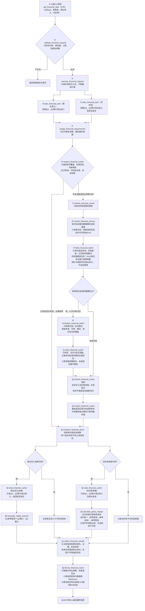

# market-data调整方案稿（2026-10-23）

> **本轮只调整市场数据MCP。公告MCP的代码、工具、缓存、文档、注册和部署完全不动。**
>
> 本文为待实施方案，更新文档不等于授权实施代码。取代2026-10-20方案稿；未完成的目标与待定事项集中在本文，完成后再并入[架构设计](<market-data架构设计.md>)及其子文档。上游客观能力仍以[支持情况](<../字段与数据源支持情况.md>)为准，不将目标覆盖写成已验证能力。

## 1. 调用顺序与模块职责

**一张图看完整调用顺序，以2026Q3单季度营业收入和毛利率为例**

图中报告期为调用示例，不表示2026Q3已披露。内部函数名为职责约定，可按实际模块组织；图示分支表示独立处理，不要求并行执行。读取、加工均不联网，取数不直接写业务缓存。读取时按批次复用相同基础数据，避免两个指标重复读盘。

## 2. 数据源分工与工具名称

### 2.1 行情与日频指标

| 数据 | SH/SZ/BJ，含A/B股 | HK | US |
|---|---|---|---|
| 不复权开高低收、成交量 | 新浪 | 新浪 | 新浪 |
| 后复权收盘 | 新浪 | 新浪 | iFinD |
| 成交额 | 新浪 | 新浪 | iFinD |
| 流通股本 | 新浪 | iFinD | iFinD |
| 总股本 | iFinD | iFinD | iFinD |
| 前复权、后复权开高低 | 用不复权价与后复权收盘计算 | 同左 | 同左 |
| 总市值、流通市值、换手率 | 用已有价格、股本及成交量计算 | 同左 | 同左 |
| PE等日频估值 | 用已有行情及财报计算，公式口径明确后纳入 | 同左 | 同左 |

新浪、东财为数据源，AKShare为调用库。iFinD近5年日期序列与窗口外基础数据补取沿用已核验写法；早期股本月频采样仍须标明覆盖与精度，不承诺逐日真实变化。价格复权与市值口径沿用现行约定。

### 2.2 财报、报表信息与营收结构

| 模块 | SH/SZ/BJ | HK | US |
|---|---|---|---|
| 资产负债表、利润表、现金流量表 | 东财，按市场通道取得实际返回的行业模板 | 东财 | 东财 |
| 公告日、更新日、币种、财报审计意见等 | 东财已有字段直接保留 | 东财已有字段保留，缺项明确标注 | 东财已有字段保留，现有SEC提交元信息关联维持，不扩展 |
| 审计单位、内控审计意见等指定缺项 | iFinD候选补充，逐字段验证参数和有效值 | 待手册及验证 | 待手册及验证 |
| 营收结构，产品/行业/地区 | iFinD | 尚无已验证方案，不承诺覆盖 | 尚无已验证方案，不承诺覆盖 |
| 财报期比率及同比 | 用已有财报本地计算 | 同左，保留当地财年与期间 | 同左，保留当地财年与期间 |

金融企业暂不做专门科目补齐或跨源拼金额，保留东财实际返回及缺项。补充字段失败不影响三表；iFinD审计字段已有空值记录，不把列出字段等同于已能补齐。市场只按后缀路由，不凭代码数字开头区分A/B股。

### 2.3 公司信息

| 模块 | 目标来源 | 已验证边界与实施条件 |
|---|---|---|
| 概况、IPO | iFinD | A股/北交所使用已验证指标；港美字段与参数单独验证 |
| 年度分红、含回购统计 | iFinD | A股使用已验证年度口径；港美年度口径待验证 |
| 一致预期 | iFinD | A股按预测年与数据日期取营收、归母等；港美另行验证 |
| 历史十大股东 | iFinD | A股/北交所使用已验证历史期与排名；港美待验证 |

公司信息全用iFinD为目标，不套用A股指标码到港美。未验证部分不自动切源；实施到对应模块前保留当前能力并明确未完成。旧A股股东缓存不可信，切源后隔离重建；不自动删除用户数据。

### 2.4 对外工具及内部命名

| 目标MCP工具 | 职责 | 与当前接口的关系 |
|---|---|---|
| `get_quote` | 行情及日频派生指标 | 保留名称 |
| `get_financial_data` | 三表、报表信息、营收结构及财报期派生指标 | 由`get_financial_statements`改名，覆盖范围更明确 |
| `get_financial_catalog` | 纯本地查询已缓存财报科目、维度及可计算指标依赖状态 | 由`get_data_catalog`改名，避免误解为全市场数据目录 |
| `get_company_profile` | 公司概况、IPO、分红、预测、股东 | 保留名称与sections分类 |
| `get_quote_chart` | 复用行情服务绘图 | 保留名称 |

不新建`get_financial_ratios`，不设含义宽泛的公开`get_data`。CLI沿用已有批处理惯例，对应使用`get_financial_data_batch`与`get_financial_catalog`等明确名称。实际改名时核对MCP、CLI、测试、导出说明及仓库内所有调用点，旧名不再注册为另一套重复工具；本次仅更新方案，不改变现有接口。

内部函数按数据域命名，如图中的`inspect_financial_cache`；行情、公司信息分别使用`quote`、`company`限定，避免同名`fetch`或`get_data`表达不同职责。

## 3. 缓存检查、刷新与指标独立性

### 3.1 唯一业务结构与成功检查范围

同一类数据的缓存及读取格式唯一，不随来源变化；行情、财报、公司信息各自定义结构。基础缓存保存上游原值及口径，派生金额与比率由加工层现算。必要的基础单位标准化须有上游单位依据，展示单位换算放输出层。

| 检查状态 | 含义 | 处理 |
|---|---|---|
| 已获取有值 | 实际取得该期该字段，真实0也属于有值 | 按新鲜度使用 |
| 已检查无值 | 上游成功响应，但该字段为空或所查报告期尚未返回 | 保存检查范围、时间与已知原因，按§3.2复查 |
| 尚未获取 | 对应范围从未成功检查 | 按需请求，不受其他范围的新鲜期阻挡 |
| 请求失败 | 网络、权限、登录、接口或写入失败 | 不记为已检查无值，不延长成功刷新时间 |

实际有值范围与成功检查范围分别保存；从未请求的中间缺期不能靠最早/最晚日期推断为已覆盖。无值不擅自解释成永久不适用；只有上游有明确依据时记录不适用原因。空响应只有能确认成功且检查范围有效时才能登记为已检查无值。

### 3.2 各模块的复查时机

| 模块 | 复查规则 | 已检查无值如何处理 |
|---|---|---|
| 东财财报及其报表信息 | 每家公司按成功检查时间保留30天刷新期；到期重新取整表历史并合并 | 在有效的已检查范围内30天不重复取；满30天复查，允许后来补入字段或报告期 |
| iFinD财报相关模块 | 最新报告期探针结果缓存1天；已拉到的历史期不因探针过期而全量重拉 | 未披露期随每日探针重新判断；已披露期已检查无值，1天内不重复取，满1天对请求涉及的空项/期按需复查 |
| 公司信息各section | 沿用30天成功刷新期，按section独立判断 | 同section成功检查的空字段到期再复查，不阻断其他section |
| 行情及股本 | 沿用实际日期覆盖与终点不足时10分钟短期复用 | 不将财报30天或每日报告期探针套到行情 |

`force_refresh=true`在财报和公司信息中跳过相应检查/刷新缓存，重查请求范围；东财物理取数仍可返回整表。每日探针只证明最新报告期，不证明营收结构、审计信息等模块已有有效值；各模块仍记录自己的检查状态。iFinD历史已有值期的更正通过显式刷新检查，东财到期整表刷新可观察历史修订。

东财30天内新披露的数据可能延迟到期后才自动发现，这是该刷新策略的边界；要求立即检查时使用显式刷新。显式请求的新范围若不在成功检查范围内，则立即请求。探针失败可沿用已知报告期并标注失败，不编造新期、不把探针失败登记为未披露。

### 3.3 指标与模块独立成败

| 失败场景 | 结果 |
|---|---|
| 营收齐全，成本缺失 | 正常返回营收；毛利率单独不可用 |
| 一项计算异常或零分母 | 仅该指标记录原因，其余指标继续 |
| iFinD营收结构失败 | 东财三表及其可计算指标继续返回 |
| 产品维度成功，地区维度失败 | 保存成功维度并返回，失败维度单独标明 |
| 刷新失败但旧值可用 | 可读取旧值计算，标为过期/刷新失败，不冒充新鲜 |
| 所有请求指标均不可用 | 返回失败及逐项原因，不宣称成功 |

缓存写入以业务上必须一致的最小批次为边界，三表与iFinD补充模块不绑成六文件全有或全无。成功批次及时持久化，后续失败不回滚此前成功批次。更新完成后复查，再按各指标依赖读取和计算；不直接跳过可用指标的加工，也不无限重拉失败项。

## 4. 财报加工与营收结构

| 内容 | 约定 |
|---|---|
| 累计/单季 | 只缓存累计原值，单季现算；Q1原值返回，Q2/Q3/Q4用同财年上一累计期相减 |
| 非加总科目 | EPS、平均股数等不直接差分，沿用现行限制 |
| 资产负债表、报表信息 | 时点值或文本原样读取，不参与单季差分 |
| 毛利率 | 用同期间、同币种、同口径营业收入和营业成本计算；不用营业总成本替代营业成本 |
| 模糊科目名 | 多候选不得擅选；沿用匹配失败及候选提示 |
| 港美报告期 | 接受上游真实报告截止日，不强制自然季度末；差分先核对财年及累计期间 |
| 三表版本 | 保留实际观察到的修订，不混接旧iFinD三表与新东财金额 |
| 市场间科目 | 保留本市场真实含义，不强行跨市场映射 |

营收结构延续已讨论的业务范围，接口写法与实测见[支持情况§7](<../字段与数据源支持情况.md#L528-L556>)。

| 项目 | 目标行为 |
|---|---|
| 来源及范围 | iFinD，A股/北交所已验证，B股另行验证；港美不承诺覆盖 |
| 维度 | 产品、行业、地区，各维度独立，不跨维度相加 |
| 期与排名 | 沿用请求报告期，每期每维度保留排名1—5共5行，不将相同排名当成跨期同一项目 |
| 原始字段 | rank、name、income、gross_profit；金额原币基础单位，保留0、空串、`--`、`-`，仅序列化缺失NaN转null |
| 加工字段 | 营收占比、毛利率现算并返回，不写基础缓存；非数值或分母不可用则仅对应派生值不可用 |
| 营收占比分母 | 同报告期东财利润表的营业总收入；该科目不可用或口径不一致时不以其他金额暗代 |
| 累计口径 | 仅披露累计原值，不随single差分；可在同次请求中与单季三表并列，输出明确各自口径 |
| 更新与版本 | 保留原计划的同期覆盖、无版本链；独立于三表，不要求六文件强一致 |
| 默认范围 | 沿用原计划纳入默认财报范围；显式只请求三表或特定指标时，不触发无关营收结构取数 |
| 维度筛选 | 使用分产品营收、分行业营收、分地区营收，与三表科目过滤互不干扰 |
| 导出 | 三表及指标为主CSV；营收结构另存同名`_segments.csv`，响应列出所有实际生成文件 |

内部服务返回结构化结果，MCP渲染Markdown、CLI/CSV输出复用该结果；不从Markdown反向解析数据。沿用现有超200行自动导出规则，明确文件中的口径、单位及缺项；绘图返回PNG。

## 5. 实施顺序与验收

> 以下均未实施。每一步先核对现有代码，验证后本地提交；不部署、不导出用户版、不推送。不得借市场数据框架调整修改公告侧或抽走其依赖。

| 顺序 | 改造内容 | 合格标准 |
|---|---|---|
| 1 | 明确取数批次、缓存检查结果、指标结果的数据契约 | 有值/无值/未获取/失败可区分；同类缓存不依赖来源 |
| 2 | 分离财报取数、适配、写缓存、只读接口和更新调度 | 取数不写缓存；只读不联网；更新后再次检查 |
| 3 | SH/SZ/BJ三表切东财，港美东财接入同一分层 | 东财整表返回正确合并；旧源隔离；30天刷新及空值检查有效 |
| 4 | 实现逐指标依赖及本地加工 | Q3自动需要Q2；缺成本仍返回营收；零分母只影响对应比率 |
| 5 | 接入iFinD营收结构及已验证报表信息补充 | 每日探针与空项复查生效；失败不阻断三表；空排名行保留 |
| 6 | 公司信息逐section切iFinD并接入框架 | 历史股东、年度分红、动态预测年份口径正确；未验证市场不冒充已支持 |
| 7 | 行情、股本及绘图接入职责划分 | 保留现有来源和复权口径；同组字段不重复请求；绘图复用行情服务 |
| 8 | 同步工具命名、CLI、文档及所有仓库内调用点 | 两入口共用业务结果；未知参数报错；旧工具名不重复注册 |

| 必测场景 | 合格结果 |
|---|---|
| 缓存齐全且有效 | 直接读取，无联网 |
| 东财成功检查无值，30天内重查 | 不重复取数，指标如实不可用 |
| 东财成功检查满30天 | 重新拉取，新增值可进入缓存，失败不延长新鲜期 |
| 新请求范围不在已检查范围 | 不被其他范围30天新鲜期挡住 |
| iFinD每日探针未到期/到期 | 1天内复用、到期重探；旧有值期不全量重拉 |
| iFinD已披露期空项到期 | 对请求范围按需复查，不把探针成功视为模块有值 |
| 任一指标/来源/写入批次失败 | 其他独立成功结果及已提交缓存保留 |
| 单季度与报表口径变化 | 缺上期自动补依赖；期间、币种或准则不符不强算 |
| A/B/北交所与港美 | 后缀路由；B股、非自然财年和上游实际模板分别验证 |
| 切源及目录查询 | 旧源不混入；目录纯本地，不联网、不写缓存 |
| 营收结构与三表组合 | 分维度保留原值，派生不落盘，独立导出与状态清晰 |
| 数据量超限及CLI部分失败 | CSV路径可用，一项失败不抹掉其他项 |
| 公告侧隔离 | 公告相关源码、接口、缓存与注册零变更 |

## 6. 仍需资料与未决事项

| 事项 | 当前边界 |
|---|---|
| iFinD报表信息 | 现有审计字段空值及参数差异待官方资料确认，不猜参数 |
| B股iFinD模块 | 三表东财已有实测；营收结构、公司信息须单独验证 |
| 港美公司信息 | 需要对应市场官方指标、参数及样本，不直接复用A股码 |
| 日频估值及特殊比率 | 明确PE静态/TTM、归母口径、币种及股本时点等公式后实现，不向iFinD直接取比率 |
| 十大流通股东 | 是否扩展仍待定，当前范围保持十大股东 |
| 行情强制刷新及复权历史重建 | 仍待定，现有行情无force_refresh，不随本轮擅自新增 |
| 精确速率、计点及渠道归属 | 未取得部分继续标明未知，不编造限额规则 |

轮外事项保留，chart旧注册暂不动；行情终点遇非交易日挂起、美股拆股日后复权OHLC还原、接口返回格式复测仍需独立核查。旧方案的31次请求、约1900点与耗时估算基于iFinD三表，已废弃，不套用到东财新流程。
