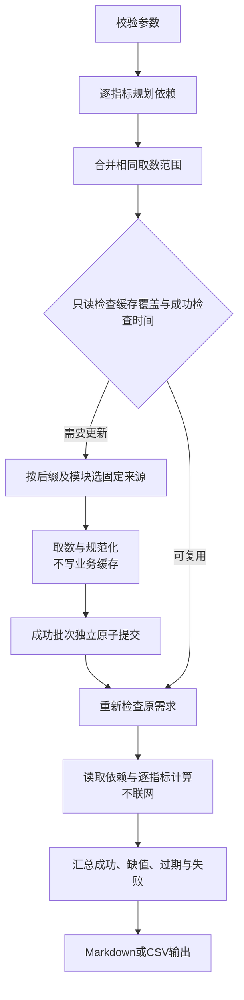

# 财报工具行为细则

本文件是`get_financial_data`的唯一完整行为规范。其他工具、共用请求层及文档归属见[架构设计](market-data架构设计.md)，上游接口、单位与实测证据见[支持情况](../字段与数据源支持情况.md)。

## 1. 参数及输出范围

```python
get_financial_data(
    code,
    amount_basis,
    periods=None,
    statements=None,
    items=None,
    include_versions=False,
    force_refresh=False,
    export_path=None,
    top_n=5,
)
```

code必须带市场后缀。amount_basis必填，取cumulative或single。statements为balance/income/cash_flow/segments/meta的非空子集，省略表示全部；显式items可以请求原始科目、派生指标或营收结构维度。

top_n为产品、行业、地区主营构成的排名上限，默认5，接受1—99的整数；布尔、浮点、字符串、null和越界值报错。MCP、CLI及帮助同契约；不影响客户/供应商前五集中度或历史十大股东。

periods省略时返回最近5个已披露报告期；显式传入时为非空YYYY-MM-DD列表，不晚于今天。A/北交所要求季度末，港美接受上游真实截止日。默认范围从实际已获取报告期确定，遵守缓存刷新周期，不将当前日历季度当作已披露报告期。

items省略返回所选报表常用科目，清单见下表。`items=["ALL_ITEMS"]`返回所选报表全部原始科目，不自动计算派生指标；如需派生指标可在同一items列表中显式追加。营收结构使用`income by product`、`income by industry`、`income by region`、`income by customer`、`purchase by supplier`五个额外item，不新增独立segments参数。

| 报表 | 默认科目 |
|---|---|
| 资产负债表·资产 | 货币资金、交易性金融资产、应收票据及账款、存货、流动资产合计、长期股权投资、固定资产、在建工程、无形资产、商誉、非流动资产合计、资产总计 |
| 资产负债表·负债与权益 | 短期借款、应付票据及账款、合同负债、一年内到期的非流动负债、流动负债合计、长期借款、应付债券、非流动负债合计、负债合计、所有者权益合计、归属于母公司股东权益合计 |
| 利润表 | 营业总收入、毛利率、营业总成本、营业成本、营业利润、合并净利润、扣非净利润 |
| 现金流量表 | 经营活动现金流入、经营活动现金流量净额、投资活动现金流量净额、筹资活动现金流量净额、现金及现金等价物净增加额、期末现金及现金等价物余额 |
| 营收结构 | 分产品、分行业、分地区营收（各维度前top_n名，精简列为名称、收入）；客户与供应商集中度（`income by customer`/`purchase by supplier`，明细第1-5大+top5合计，见§5） |
| 报表信息 | 报告截止日、公告日、币种、审计意见、内控审计意见、审计单位 |

默认清单名用于请求；A股输出用规范全名，`合并净利润`显示为`净利润`，`扣非净利润`显示为`归属于母公司股东的扣除非经常性损益的净利润`；其他市场保留上游原名。

港股另有独立默认清单，只列东财港股模板近5期实际有值的科目，不为对齐大陆清单凑数：

| 报表 | 港股默认科目 |
|---|---|
| 资产负债表 | 现金及等价物、应收帐款、存货、流动资产合计、联营公司权益、物业厂房及设备、非流动资产合计、总资产、短期贷款、应付帐款、流动负债合计、长期贷款、非流动负债合计、总负债、少数股东权益、净资产、股东权益、总权益及总负债 |
| 利润表 | 营业额、营运收入、销售及分销费用、行政开支、经营溢利、融资成本、除税前溢利、除税后溢利、股东应占溢利、每股基本盈利 |
| 现金流量表 | 经营业务现金净额、投资业务现金净额、融资前现金净额、融资业务现金净额、现金净额、期初现金、期末现金 |
| 报表信息 | 报告截止日、币种 |

港股营收结构默认不请求（上游无已验证通道）；港股利润表的原始科目`毛利`与大陆计算指标`毛利`同名，比率口径确定前不列入默认清单。除港股外的市场沿用大陆清单。

沪深A/B股及北交所的科目名在共用输出层处理：优先使用已核验名称，其次使用已核实的东财网页标签或源分类名称。中文名称可用于items匹配，代码精确请求仍有效；没有可靠释义的字段保留原名，有值时在notes列明。标签仅用于命名，不据此合并金额、删除空值或消除上游语义疑点；来源标签及核验边界见[支持情况](../字段与数据源支持情况.md#财报中文标签与单位补测2026-10-30)。

已核验的三个手续费旧码在中文名后标“（旧字段）”，与现行字段分别保留，不设公司或年份分支、不据样本同值自动合并。`ABLE_OCI_OTHER/UNABLE_OCI_OTHER`使用对应可重分类/不可重分类类别下的“其他项目（东财汇总项）”；`OCI_OTHER`保留为“其他综合收益其他项目（东财原始项）”。三项不固定映射到某家公司具体分项，不相加、去重或拆造保险合同明细。CLI逐行note与CSV的note列保留汇总/潜在重复说明，MCP信封notes显示相同说明；三个旧手续费字段也提示不得重复相加。默认匹配、多候选报错及原值精度不变。

毛利率是默认清单中的计算项；其他派生指标须显式请求。源科目保留真实含义，缺项如实标注，不用相近科目暗代，不强行跨市场映射。科目匹配依次使用代码或名称精确匹配、已确认同义名、顺序关键词；多候选失败并列出候选，不擅选。

## 2. 来源与职责

三表在SH/SZ/BJ/HK/US均使用东财实际返回的合并报表及行业模板。金融企业不跨源补金额、不为单家公司适配。报表信息保留东财同一语义的有效值；财报审计、境外财报审计及内控审计意见彼此独立，不互相代替。

沪深A/B股及北交所请求报表信息时，仅对12-31年报、请求字段中东财缺失的审计单位、财报审计意见、内控审计意见或实际披露日调用iFinD补充。采用[支持情况补测](../字段与数据源支持情况.md#围海主营年报审计与ipo补测2026-10-30)的已验证原式，不把年报结果填到季报或中报，不覆盖东财有效值。仅请求普通三表金额不因此强制调用iFinD。报表信息行的source标实际取值来源，信封source汇总实际使用的来源；报告期与披露日分别保留。

其中东财原始`OSOPINION_TYPE`只表示境外财报审计意见；内控使用独立内部键`INTERNAL_CONTROL_OPINION`，值来自iFinD已验证的内控意见原式。境外键有值不能阻止内控补充，不因所选报表组合改变内控来源；补充失败、空值或非年报时不得借用境外意见。新增显式item“境外审计意见”读取东财资产表元信息，避免利润表缺列；默认报表信息清单保持原六项，ALL_ITEMS包含全部已知元信息项。帮助的meta_items列出可请求名称。MCP报告期附表将境外与内控分行，未请求补充时仅展示已有值，不为附表隐藏取数。

营收结构使用iFinD沪深（含B股）及北交所通道；B股样本与有效值覆盖见[支持情况§7](../字段与数据源支持情况.md#b股公司信息与营收结构补测2026-10-29)，港美不宣称覆盖。美股保留既有SEC提交元信息关联，SEC失败不阻断东财三表。

处理顺序如下。图中独立分支不要求并行执行。



主要实现为financial_contract.py、financial_service.py、providers/financial_statements.py、providers/company_ifind.py、data_store.py及financial_cache.py的版本合并函数。读取与计算不触发隐藏取数。iFinD容灾统一遵守架构设计§8，不在业务层叠加重试。

## 3. 缓存与检查状态

新缓存位于`cache/{完整代码}/financial_data/`。旧financial_statements目录保留，但不进入新通道，避免旧iFinD三表与东财金额混接。

| 文件 | 内容 |
|---|---|
| balance.json、income.json、cash_flow.json | 各报表的reports、versions、items、检查范围及时间 |
| segments_product.json、segments_industry.json、segments_district.json、segments_customer.json、segments_supplier.json | 各维度逐期原值及成功检查时间，同期覆盖，无版本链 |
| report_probe.json | iFinD最新报告期及成功探测时间 |
| report_info_ifind.json | iFinD年报补充元信息，按报告期保存原值与成功检查时间 |
| sec_filings.json | 美股既有SEC提交元信息 |

报表文件的meta包括schema_version=2、来源及最近成功更新时间；checks按实际报告日期记录成功检查时间。实际有值范围和检查范围分别维护，不能从最早、最晚日期推断中间都已检查。三表同类业务结构不随来源改变。

每期按reports组织，current_version_id指向versions中的当前版本。版本含原始items及报告元信息，原值0、null、空串均保留。必要的基础单位标准化须有来源依据；展示换算放输出层，派生结果不写基础缓存。

| 状态 | 处理 |
|---|---|
| 有值 | 使用原值，包括真实0 |
| 已检查无值 | 保存成功检查范围及时间，不擅自解释为不适用 |
| 尚未获取 | 按需取数，不受其他范围新鲜期阻挡 |
| 请求或写入失败 | 不冒充已检查空值，不推进成功刷新时间 |

东财按成功检查范围保留30天刷新期，到期重新取相应整表历史并合并。物理返回的实际报告期及显式请求但未返回的日期都记入检查范围，未检查的新日期立即请求。默认请求30天内可复用已知报告期，可能延迟发现新披露数据；需要立即复查时显式force_refresh。

iFinD最新报告期探针有效1天，只用于确认报告期，不证明营收结构已有值。已披露期成功检查过的有值、空值不自动重拉，force_refresh才重查；新维度、新报告期仍属未获取。探针失败保留已有锚点并注明；没有锚点时不将失败登记为未披露。

主营每维度每报告期缓存另记top_n检查上限和exhausted末项标记。旧格式按原前5名覆盖理解；扩大N续取未覆盖排名，缩小N只筛选输出，不覆盖已有更多数据。遇全空末项的结果可满足更大N；force_refresh从排名1重查请求范围，较小范围强刷后范围外旧记录保留，但不能据新时间冒充已刷新完整范围。扩容、刷新或写入失败保留原缓存与检查时间，旧排名可用时返回partial_success并标stale。

年报补充独立缓存30天，成功空值也复用，未检查的新期立即获取，force_refresh重查；失败不推进成功检查时间，已有旧补充值可用时保留并标stale，独立三表结果不回滚。iFinD补充只在读取输出时合并，不改写东财报表缓存、金额或已观察历史版本。

`report_info_ifind`旧缓存中，已校验meta.source=ifind的data.OSOPINION_TYPE来自旧版iFinD内控取数，读取时映射到INTERNAL_CONTROL_OPINION；新键已存在时以新键为准，旧键不再作为境外字段合并。不写回原文件、不重置checked_at、不因换键重新取数；过期或force_refresh仍遵守上段。该兼容仅限独立iFinD补充缓存，绝不作用于东财原始报表、版本或其他来源缓存。

每张报表或一个营收结构维度报告期是独立业务提交批次。先写临时文件、校验JSON序列化、再原子替换；失败保留原文件。成功批次及时持久化，其他模块失败不回滚。不再要求三表及补充模块全有或全无。

共用data_store.write仅在原子替换遇Windows winerror=5时，对同一已序列化临时文件最多额外尝试3次，间隔0.05、0.10、0.20秒，总等待上限0.35秒；不重新取数、不修改权限或文件属性。其他错误立即抛出，持续拒绝访问在次数耗尽后仍抛出原始异常；失败不替换原文件、不推进成功检查时间，临时文件按既有流程清理。该分支用于短暂句柄占用，不把所有WinError 5解释为同一原因。

## 4. 单季度与计算指标

基础缓存仅保存累计原值。资产负债表与文本信息原样读取；利润表、现金流量表的Q1单季等于累计，Q2/Q3/Q4取同财年本期累计减上一累计。依据上游真实财年及季度身份定位，不把港美截止日强制套自然季度。身份、期间连续性、币种或会计准则无法确认时不强算。

EPS、每股股息、加权平均股数等非加总项不差分。调用方只传目标报告期；缺少的依赖期自动处理，但不进入显式请求或默认5期的输出。东财物理获取整表历史可以同时满足这些依赖，避免逐指标重复请求。

| 指标 | 公式 |
|---|---|
| 毛利 | 营业收入－营业成本 |
| 毛利率 | 毛利÷营业收入 |
| 合并净利率 | 合并净利润÷营业收入 |
| 归母净利率 | 归母净利润÷营业收入 |
| 扣非净利率 | 扣非净利润÷营业收入 |
| 资产负债率 | 负债合计÷资产总计 |
| 科目名同比增长率 | （本期值－上年同期值）÷上年同期值 |
| 科目名环比增长率 | （本季度单季值－上一季度单季值）÷上一季度单季值 |

利润类金额与净利率随amount_basis确定累计或单季口径。资产负债率始终为时点值。同比跟随请求口径；环比始终比较单季度，Q1使用上一财年Q4。增长率只支持可加总金额科目，不扩展到EPS或比率本身。

增长率基期为0、负数或非数值时不可用，返回原因及比较金额，不自动改用绝对值分母。其他比率分母为0时不可用，负分母按公式保留并提示。营业成本缺失只影响毛利及毛利率，不阻断营业收入。全数不可用返回失败，部分可用返回partial_success；刷新失败可读旧值并标stale。

## 5. 营收结构

维度独立，不跨维度相加；产品、行业、地区按排名顺序获取至top_n，基础缓存保留rank/name/income/gross_profit。名称、收入、毛利全部为null或空字符串时停止后续排名，缓存保留该末项空行作为覆盖依据，输出不补空行。真实0、负值和文本占位不视作全空。仅返回前N名不代表分类已全部覆盖，N=99也不是所有公司的实际分类上限。客户和供应商行结构见§5.1。

默认输出仅精简主营字段列，仍返回请求排名范围内的实际记录；不再把每维度裁成一行。显式维度item或ALL_ITEMS返回完整字段及可计算的营收占比、毛利率。客户/供应商不受默认精简或top_n影响，前五明细和合计均保留。

同指标不同排名必须分次调用，不能以排名认定跨期同一项目。保留上游0、空串、--、-，只将序列化缺失NaN转null；数值字符串仅在计算时解析，原缓存与原字段不改写。派生值不落盘，分母或毛利不可用仅影响对应派生值。

营收占比分母为同报告期东财累计营业总收入，科目缺失或口径无法确认时不暗代。毛利率用该分部毛利除收入。营收结构与普通三表科目的内容过滤独立，可在同次请求中一起返回；single跳过营收结构单季差分，保留累计值并在notes说明。

### 5.1 客户与供应商集中度（2026-10-26）

`income by customer`与`purchase by supplier`两维度：每报告期输出rank 1-5明细行（`name`+`ratio`，第N大客户/供应商名称及占比）加一条`rank="top5"`合计行（前五大合计占比，无name）。ratio为比值（上游返回百分数，除以100），0.2406表示24.06%。

客户与供应商对称，共用同一套行为：正常返回的空值如实保留，不当作请求失败。逐码请求及参数写法遵循[支持情况§7](../字段与数据源支持情况.md#7-ifind-接口实测矩阵)的集中度实测，不在此重复维护错误码、样本及调用次数。

## 6. 版本、展示与导出

原始报表按实际观察内容的哈希保留修订版本，未重新返回的旧期不删除。默认原始科目只读当前版本；include_versions=true在累计口径展示已观察历史版本，在single口径只显示当前累计版本并在notes说明。派生指标始终用当前累计版本计算，依赖版本记入rows的derived_from_version_ids；查询include_versions时信封按报表与报告期去重返回，含单季差分用到的上下期。不制造历史单季版本或未观察的修订。

### 6.1 输出契约

MCP只返回JSON信封与markdown，rows不对外；CLI保留结构化rows，CSV为长表。信封固定字段如下，未列出的不输出。

| 字段 | 含义 |
|---|---|
| ok、status、stale | 成功标记；success/partial_success/failed；是否因刷新失败读旧值 |
| code、market、statements | 带后缀代码、市场、实际输出涉及的报表（不是请求值） |
| amount_basis、include_versions | 回显请求口径 |
| periods | 报告期，升序；显式请求的期原样回显（缺值见failed_items），默认取实际最近5期 |
| versions | 仅include_versions=true且存在依赖版本时返回：报表→报告期→版本id列表 |
| failed_items、notes | 失败项与口径说明 |
| source、units | 实际来源及量纲说明；金额、每股金额、股数、比值、文本见下文 |
| markdown | 数据本体 |

不返回date_range，范围由periods表达。markdown按报表分块，标题如`## 利润表（value_basis=single）`；数据表为科目×报告期，另列单位；版本审计表也列单位。金额及每股金额两位小数，比值为百分数，缺项留空。数据块之后附`## 报告期元信息`，行为公告日、东财更新日、货币、审计意见，列为报告期；请求statements含meta时不再重复该块。single请求在notes首条说明`single为单季值：Q1使用累计报表原值，Q2/Q3/Q4=本期累计−上期累计`。

普通报表金额的unit为`原币基础单位`，基本/稀释每股收益及已识别每股金额为`原币/股`，加权平均股数等为`股`，已计算比值为`ratio`，报表信息为`text`；股本金额仍属金额，不因名称带“股”而改为股数。币种仅取报告期元信息，不从上市市场推断。CLI rows及CSV共用unit，信封units分别说明amount/per_share/shares/ratio/text。原始金额、精度与版本不变，本工具不增加万元/亿元展示换算。

上述命名与单位在读取输出时应用，旧缓存不必重拉。主表、补充资料与备用字段分别保留，名称带相应中文限定；同次输出同一报表的不同代码仍同名时，按代码排序分别追加“（同名字段1）”等标记，避免Markdown合并覆盖。标记只区分本次输出中的同名项，不作为跨请求主键；不额外公开内部科目码，缓存保留原始代码用于追溯。

比率原值0.25表示25%，不把比率误作金额。缺项、来源、期间与口径随结果保留。source更新日、公告日、报告截止日各自独立，不混称。

营收结构在累计口径总标题下分为“主营构成”和“客户/供应商集中度”两张表。主营构成使用报告期、维度、排名、名称、收入、营收占比、毛利、毛利率，对应report_date/dimension/rank/name/income/income_share/gross_profit/gross_margin；集中度使用报告期、维度、排名/汇总、名称、占比，占比读取ratio。每张表只显示该组结果实际包含的字段列，字段存在但值为空时保留空单元格，不因展示需要扩大默认精简范围。

rank="top5"在排名/汇总列显示“前5大合计”，名称仍保留上游空值；普通排名显示原值。金额沿用既有格式化，比率以两位小数百分数展示，0、负值和超过100%的值均保留，文本占位原样显示。CLI结构化数据及CSV保持原字段，MCP不额外返回第二份rows或segments数据体。

### 6.2 导出

超过200行自动CSV；显式export_path直接导出，不先返回海量正文。营收结构另存同名_segments.csv，响应paths列出所有实际生成文件。CLI多公司共用export_path时为文件名附证券代码，避免覆盖。批处理一家公司失败不抹掉其他公司的成功结果。

MCP仅注册get_financial_data，CLI为get_financial_data_batch。旧名不作为第二套工具注册。帮助与缓存查询统一使用架构设计§4的get_market_data_help。
